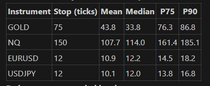

# COG Snippets

Short messages from C.OG (Colez Trades) and the Discord worth keeping: odd answers,
rules of thumb, worked examples. One entry per snippet, newest at the bottom.

Each entry has:
- **the snippet as posted**, verbatim, with names and channel;
- **the explanation**, which is ours and is kept separate so the original stays clean;
- **how it maps to this repo**, where it does.

The longer course material lives in `micro learning bank.md`. This file is for the
one-off messages.

Longer C.OG videos have their own notes files:
- `progression-path-breakdown-notes.md`: variance vs drift, the benchmark, paper
  trading, and prop-firm challenges net of costs
- `macro-variable-context-relevance-notes.md`: a macro series leading NQ, and the
  confirmation lag

---

## 1. Stop placement from an MAE table: "none of the above" (#Vip-Discussion, 2026-09-26)

**Context:** Jordan (CT) ran an MAE analysis on a forecast's trades and asked C.OG which
statistic to set the stop from: mean, median, P75 or P90.

**The table as posted:**

| Instrument | Stop (ticks) | Mean | Median | P75 | P90 |
|---|---|---|---|---|---|
| GOLD | 75 | 43.8 | 33.8 | 76.3 | 86.8 |
| NQ | 150 | 107.7 | 114.0 | 161.4 | 185.1 |
| EURUSD | 12 | 10.9 | 12.2 | 14.5 | 18.2 |
| USDJPY | 12 | 10.1 | 12.0 | 13.8 | 16.8 |

**Jordan's question:** "Mean median p75 or p90?"

**C.OG's response (verbatim):**

> none of the above xD
>
> The correct approach:
> So model and test in the data what changes does actual yield any predictive power
> That's then going to be your noise threshold
> Anything below that you don't include
> Then past that threshold you're then going to have a noise threshold for each horizon type
> Let's say
> 2 weeks
> 1 month
> 1.5 months
> 2 months
> So on all the way up to maybe 6 or 12 months
> This will then give you a distribution of results so you can can then see what carried the best value

**The analogy that followed (verbatim):**

> The everyday analogy first: imagine you're deciding how many layers of clothing to wear
> tomorrow, and you only get to look at "the weather over the last N days" to decide. Look
> back just 1 day and you might catch a freak warm afternoon and underdress. Look back a
> full year and you'll always get "average" advice that ignores you're actually in the
> middle of a cold snap right now. Somewhere in between is a window long enough to smooth
> out random daily noise, but short enough to still notice "oh, it's actually gotten colder
> this month" before you're shivering. That's exactly the tradeoff being tuned here — just
> for stop-loss distance instead of jacket thickness.

### Reading the table

**MAE (maximum adverse excursion)** is how far each trade went against you, at its worst
point, before it finished. Each row summarises that across all of an instrument's
trades, in ticks:

| Column | What it means |
|---|---|
| **Stop (ticks)** | The stop distance currently in use |
| **Mean / Median** | The average and the middle trade's worst drawdown |
| **P75 / P90** | 75% / 90% of trades had an MAE no bigger than this |

MAE values run past the stop (EURUSD's P90 is 18.2 against a 12-tick stop). That means
it was measured on the **forecast's path**, as if no stop had been hit, which is what you
need for this question.

**Where each current stop sits in its own distribution:**

| Instrument | Stop vs MAE | Roughly how many trades breach the stop | Read |
|---|---|---|---|
| GOLD | 75 ≈ P75 (76.3) | ~25% | The mean (43.8) is far above the median (33.8): most trades barely go against you, a minority go a long way |
| NQ | 150, between median (114) and P75 (161) | ~30–35% | Mean below median: MAE bunches toward the high side |
| EURUSD | 12 ≈ median (12.2) | **~50%** | The stop sits in the middle of normal adverse movement |
| USDJPY | 12 = median (12.0) | **~50%** | Same |

**What stands out:** the FX stops are at the median MAE. Half of all trades, winners and
losers alike, touch the stop at some point. On those two pairs a 12-tick stop is mostly
measuring noise, not being wrong.

**A units caveat:** "ticks" on EURUSD could mean pipettes (0.1 pip, so 12 ticks = 1.2 pips)
or pips. At 1.2 pips the stop sits inside the spread plus ordinary jitter, which would
explain the median MAE landing exactly on it. Worth confirming.

### Why "none of the above"

Picking the mean, median, P75 or P90 treats the stop as a **description** of past
drawdowns. Every percentile is arbitrary unless you know what an adverse move of a given
size **tells you about the trade's outcome**. Two problems with reading the table
directly:

1. **Winners and losers are mixed together.** The useful question isn't "how far do
   trades go against me?" but "beyond what distance does going against me predict the
   trade will lose?" A stop should sit where adverse movement stops being normal noise and
   starts being information. Classic MAE analysis (John Sweeney) splits the MAE of
   **winners** from **losers** for this reason. If winners almost never go beyond X
   against you, a stop just past X cuts losers without killing winners.
2. **One distribution hides the time dimension.** The size of "noise" depends on the
   volatility regime, which depends on how far back you measure.

### What C.OG is describing, step by step

1. **Find the noise threshold.** For a range of stop distances, test in the data whether an
   adverse move of that size changes the trade's expected outcome. Below the threshold,
   adverse moves have **no predictive power**: winners and losers look the same, so it's
   noise and the stop must sit beyond it. Where adverse excursion starts to predict a worse
   outcome is the noise threshold.
2. **Repeat per look-back horizon.** Estimate that threshold from trailing windows of
   2 weeks, 1 month, 1.5 months, 2 months, and so on up to 6–12 months. That's the
   weather analogy: 1 day overreacts to a freak afternoon, a year ignores the cold snap
   you're in.
3. **Compare the distribution of results across horizons.** For each look-back, run the
   strategy with the stop set by that look-back's threshold and look at the whole
   distribution of results (expectancy, drawdown, win rate), not one number. Pick the
   window that carried the best value.
4. **Guard against overfitting.** Choose the window in-sample and confirm it
   out-of-sample. With ~10 windows × 4 instruments tried, some will look good by chance.
   (This last step is ours, not in the message, but it follows the same discipline.)

The natural result is a stop that **adapts**: "k × the recent noise level measured over
the chosen window", rather than a fixed 12 or 75 ticks.

### How it maps to this repo

- Every backtest results card here already exports **MAE per trade** (the house CSVs:
  `Date,Return %,MAE %` and `date,R,MAE (R)`). MAE must come from the real intra-trade
  path (CLAUDE.md). So the raw input for this analysis already exists for every engine.
- **R-multiples** already express MAE in risk units. That's the vol-adjusted version of
  "ticks", so thresholds compare across instruments and regimes.
- **Not yet built:** a stop-distance sweep that finds the noise threshold per look-back
  window and compares expectancy across windows. It would be a natural reusable brick:
  trade log with the MAE path in, noise threshold and results by look-back out.

## 2. Dealer-hedging chart preview: ES strike map (#Vip-Discussion, 2026-10-18)

**Observed (screenshots, 15:41–15:44 UK).** C.OG posted a chart of ES Dec-26 (ESZ2026) options: open interest per
strike (puts yellow left, calls blue right), two fans of per-strike curves labelled "PUTS IV LESS ATM −2 pt … +4 pt" and
"CALLS IV LESS ATM +4 pt", a white line on the left, and these levels: spot 7,811.54, major wall 7,800, max pain (Oct 12)
7,750, total gamma flip level ~7,745, zero gamma ~7,725.22, flip (zero crossing) ~7,859.12. Then four price charts with
7,800 and 7,725 marked (a bounce near 7,725 on the 15th, a stall and chop at 7,800 overnight, then a break down
through 7,725 to ~7,680) and two example trades: long 7,725 → 7,800 (stop 7,712.50); short 7,800 → 7,615
(stop 7,820.25).

> This is an insight into dynamic hedging requirements, conditional feedback loops and market flows
> And a lot more factors at play that I'll be showing very soon
> ( this can be used on a day to day basis and will be extremely beneficial for system developments)
> Don't worry if this makes no sense just yet as I'll be explaining it all in significant detail within the content

**Not stated by C.OG (open):** whether the curves are delta or gamma, which expiries feed it, the IV source, and how
"flip (zero crossing)", "total gamma flip" and "zero gamma" differ.

**Inference (ours).** The fans look like each strike's exposure re-priced at hypothetical spots under IV shifts; the white
line looks like an aggregate hedging requirement against price. The circles were drawn after the move, and the same level
read as support (bounce) and as acceleration (break), so the screenshots cannot test anything. Prior verdicts that apply:
gamma-sign → next-day range is REAL on NQ; walls/flips as levels are NULL (wall placebo, G3, ripple walls). Rebuilt as
the "Dealer hedging map" (05c) on `oi-dashboard-v2.html` (engine `js/hedgingScenario.js`), 2026-10-18.

## 3. VVIX vs Nasdaq "pricing ratio" (Discord, 2026-10-23)

**Observed (screenshot, 12:03–12:08 UK).** Jordan asked C.OG for insights ("anything at this point", posting a chart of
gold against an inverted US 10Y yield, 15-min). C.OG replied:

> Take a look at the ratio between how vvix and Nasdaq are pricing in information
> So model it as a ratio and say for every % Nasdaq prices in what is the relative priced in % of vix all per unit time
> and then you want to create a time series of that ratio and see how it looks over time and when that ratio is at an extreme
> What then happens
> Will be very interesting
> Might even just get yourself a system idea from this

**Not stated by C.OG (open):** whether "priced in" means realised moves or implied vol; whether the second leg is VVIX or
VIX (he names VVIX, then writes "vix"); the unit of time; what "extreme" means; what to look at afterwards.

**Inference (ours).** Three readings, registered as separate constructions in `forge/VVIX_NASDAQ_RATIO_PREREG.md`:
(a) realised: % move of VVIX per % move of Nasdaq over a window (ratio of realised vols); (b) the same with VIX;
(c) implied: VVIX ÷ VXN (vol-of-vol priced per unit of Nasdaq vol). Jordan's gold-vs-inverted-10Y chart is the known
same-day real-yield link (ledger `which-gold`, context); it is drawable on cog-chart.html (preset "Gold vs inverted US 10y
real yield").

### 3b. The same thread, clarified (Discord, 2026-10-23, 12:21–12:45 UK)

**Observed.** Garin described VVIX as "expected volatility of VIX itself, derived from VIX options"; C.OG: "This is a good
explanation". C.OG then (to Jordan, about calculus: bond cash flows as integrals, Brownian motion accumulating over time):

> How quickly the ratio is changing could be modelled as dR/dt
> Where R is the relative change of vix % at time t / the relative change of Nasdaq % at time t
> Just make sure to factor in the sign as they're negatively correlated

**What this settles (stated by C.OG):** the ratio is **VIX** (not VVIX) % change over Nasdaq % change, **signed**; and its
rate of change dR/dt is of interest. **Still open:** the time step, how to handle a near-zero Nasdaq move in the
denominator, what "extreme" means.

**Inference (ours).** Over a window, a signed % change ratio is the slope (beta) of VIX % changes on Nasdaq % changes
(normally negative; it equals the unsigned ratio of the first test x the VIX-Nasdaq correlation). Tested as a follow-up,
`forge/VIX_NASDAQ_BETA_PREREG.md`: the beta level and its rate of change at extremes.

**A friend's intraday version (2026-10-23).** Rich shared a friend's own study of this ratio: VIX % per 1% index move since 10:00 ET, read hourly, outcome to 16:55, in-sample 2016-2020. ES shows a small lean up when the VIX reacts hard (4/5 and 5/5 years); NQ shows no pattern, and they found dR/dt hourly to be noise. It is in-sample only and has not been corrected for the number of buckets. The screenshots, numbers and how it sits next to our daily tests are in `education/friend-vix-ratio-intraday/NOTES.md`.
