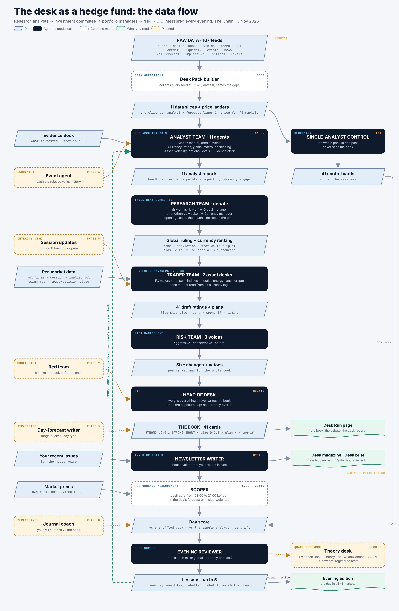

# Desk Analyst Pipeline: design

*Started 2026-11-03 on branch `ccr-4824155b-3im5ze`. Register row: `desk-analyst-pipeline`. Status: Phases 0, 1 and 2 built.*

## 1. What this is

Every morning, one run turns the desk's own data into a set of professional outputs: the newsletter, a directional
analysis, a forecast of the day, trade ideas, and a risk & events briefing. The run is a chain of **skills** (role
prompts). Each skill reads a defined slice of the data, writes a short typed report, and hands it on.

The structure is borrowed from [TauricResearch/TradingAgents](https://github.com/tauricresearch/tradingagents)
(analysts → bull/bear researchers → research manager → trader → aggressive/conservative/neutral risk desk →
portfolio manager → memory). Their data (equities, SEC filings, Reddit) is not used. Neither is their central idea that
the LLM *is* the trading signal (see §3).

The home is **Atlas** (`atlas.html`): it already reads most of the feeds below and carries the newsletter.

## 2. The owner's method: top-down

All analysis runs **global market → currency impacts → assets (FX, indices, commodities)**. The pipeline follows
that order at every layer:

1. **Global.** What is the world doing? Risk tone, credit, funding, liquidity, cross-asset regime, what's on the calendar.
2. **Currency.** Given that, what happens to each of the eight currencies (USD EUR GBP JPY AUD NZD CAD CHF)? Rates,
   central banks, yields, macro prints, positioning.
3. **Asset.** Given the currency views, what does each instrument do today? Vol and implied vol, options open
   interest, levels and structure. Pair views come from the two currency views; indices and gold from the global
   view plus USD and rates.

## 3. Rules the design holds to

1. **The LLM layers add context; they never create a signal.** Trade permissions come from the engines that have been
   tested (`DecisionEngine/`, `Trade_Decision_Engine/`). A skill may say "the bear case is strong, size down". It may
   never turn "no shorts" into "short".
2. **Evidence first.** An Evidence Clerk skill hands every debater only the Evidence Book entries (`js/deskEvidence.js`)
   relevant to its claims, so nobody argues from a banked null. Long-context obedience is where cheaper models fail
   silently (`js/modelRouter.js` header), so each skill gets **only the entries that matter to it**, not the whole
   ledger.
3. **One pack per day.** Every skill reads the same Desk Pack (Phase 0). Nothing fetches its own data mid-run, so what
   each skill saw is known and can be graded.
4. **Gaps are stated.** A missing, empty or stale feed reaches the skill as a gap with its reason ("Fed path odds not
   loaded; last read 2026-10-28"). It is never read as "nothing happened".
5. **Typed outputs.** Every skill returns JSON against a schema. A decision with no readable rating is `REVIEW`, never
   a silent Hold (TradingAgents' `rating.py` rule).
6. **Judges must commit.** Managers weigh the cases and choose the stronger side, sized by how clearly it wins.
   Neutral only when the evidence really is balanced or too thin. This is their prompt rule, kept.
7. **Measured, not assumed.** Day forecasts and directional calls are logged and scored. Whether the pipeline beats
   the current single prompt (`/api/analysis`) and the engines alone is a pre-registered question (§8), not a belief.

## 4. Architecture

```
Layer 0  Desk Pack (no LLM)            one dated snapshot of ~107 feeds, gaps marked          ← BUILT (Phase 0)
Layer 1  Analysts (parallel, cheap)    11 skills, one typed report each
Layer 2  Top-down debate               2a Global: risk-on vs risk-off → Global Manager
                                       2b Currency: strengthen vs weaken, per currency → Currency Manager
                                       2c Asset: Research Manager per instrument (pair = ccy A vs ccy B)
Layer 3  Trader + risk desk            plan per instrument; Aggressive / Conservative / Neutral → Head of Desk
Layer 4  Writers                       newsletter · directional · day forecast · trade ideas · risk & events
Layer 5  Memory                        log every call, grade it, feed lessons back to the managers and writers
```

### Layer 1: analyst skills and their feeds

The feed registry is `js/deskPack.js` (`DESK_FEEDS`, `DESK_INSTRUMENT_FEEDS`). `GET /api/desk-pack/feeds` lists it live.

| Layer | Skill id | Reads (`/api/…`) | Pages it stands for |
|---|---|---|---|
| global | `global_market` | global-read, wider-market, risk-flags, regime, hmm/regimes, macro-regime-fx, gpr, crack, gold-etf-flow, desk-watch, spread-episodes/live, trend-basket, daily-snapshot, market-sense/last | Market View, Terminal, Surface Lab, Market State, Regime, Spread-turn episodes, Market-Sense |
| global | `credit_funding` | credit-stress, credit-quality, bank-credit, funding-read, liquidity-pulse/data, liquidity-gate/live | Stocks/bonds & credit, Bank credit & funding, Book Stress, Global Liquidity |
| global | `events_news` | calendar-ahead, events, event-day, release-calls, news-outcome, earnings-ahead, fiscal/events | Event Book, Release why/reaction, Labour market due, The Feed, Fiscal Events |
| currency | `rates_cb` | rates, rate-diff, rates-regime, fed-path, fed-speakers, {fomc,ecb,boe,boj,boc,rba,rbnz,snb}/latest, beigebook/latest, treasury-auctions | Rates & Policy, Fed Path Odds, 8 CB Sentiment pages, Rate Matrix, Beige Book |
| currency | `yields_curve` | yield-curve, intl-yields, real-yield, yield-context, yield-coupling, yield-spread/plan | Yield Curve, Real Yield, Yield-Shape Regime, Rate legs vs price, Rates vs Nasdaq |
| currency | `macro_economy` | cpi, ppi, gdp, ism, labor-market, retail-sales, trade-balance, consumer-confidence, econ-surprise, econ-trend, nowcast, macro-scorecard, macro-changes | CPI … Consumer Confidence, Macro Scorecard, The Economies, The Week Scored |
| currency | `cot_positioning` | cot-state, cot-extremes, oanda-book/history | COT Extremes |
| asset | `vol_iv` | vol-forecast (+ /session, /weekly, /intelligence), cvol, forecast-path/summary, forecast-path/iv, exhaustion-ladder, daily-read, today-reads | Vol Forecast v2/v3, Expected Moves, Daily Read, Exhaustion research, Forecast Path, Live Range |
| asset | `options_oi` | oi-today, oi-levels, chain-read, swing-map × 11 instruments | OI Analytics, OI Lab (v2), Open interest, Swing Map |
| asset | `levels_structure` | levels, asia-today, weekmap, range-calls, daily-open-fib, trade-decision/state × 8 FX pairs | Level Scenarios, Level/Fib Atlas vote portfolios, Asia Fib Atlas Live, Daily Plan, Trade Decision |
| evidence | `evidence_memory` | ledger, direction-ledger, forward-track, data-health, morning-brief, eod-review (+ `js/deskEvidence.js` read directly) | Evidence Book, Chapters, yesterday's brief and review |

The research and backtest pages (Vol BT, Decision-Zone BT, Forecast Line Backtest, Portfolio Book, Rich-Vol Break
Record, Bot Audit, Honest Harness …) are **not daily feeds**. Their verdicts reach the pipeline through the Evidence
Book, via the Evidence Clerk.

Universe (owner, 2026-11-03): **every instrument the vol forecast covers**, 41 names (`DESK_UNIVERSE`, kept equal
to `js/volForecastScheduler.js` INSTRUMENTS by a test):

| Group | Instruments | Read from (legs) |
|---|---|---|
| FX majors | EURUSD GBPUSD USDJPY AUDUSD NZDUSD USDCAD USDCHF | base and quote currency views |
| FX crosses | GBPJPY EURGBP EURJPY EURCHF GBPCHF AUDJPY CADJPY EURAUD EURCAD EURNZD GBPAUD GBPCAD AUDCAD NZDCAD NZDJPY | base and quote currency views |
| Indices | NQ SPX500 US30 US2000 DE30 UK100 | home currency (USD, EUR for DE30, GBP for UK100) + global view |
| Metals | GOLD SILVER COPPER PLATINUM PALLADIUM | USD + global view |
| Energy | WTI BRENT NATGAS | USD + global view |
| Ags | SOYBEAN WHEAT CORN SUGAR | USD + global view |
| Crypto | BTCUSD | USD + global view |

Every leg is one of the eight currencies, so the currency layer stays at eight debates however wide the asset layer
gets. Swing map and trade-decision state exist only for a subset (`DESK_SUBSETS`); the other instruments are read
from the vol forecast, levels and the currency views.

### Layer 2: top-down debate

| Step | Roles | Reads | Writes |
|---|---|---|---|
| 2a Global | Risk-On advocate vs Risk-Off advocate, 1–2 rounds → **Global Manager** | global analyst reports + evidence | `global_view`: regime, risk tone, conviction, drivers, what would flip it |
| 2b Currency | per currency: Strengthen vs Weaken advocate, 1 round → **Currency Manager** (one call ranks all eight) | `global_view` + currency-layer reports + evidence | `currency_views[8]`: bias, conviction, drivers, flip conditions; a strength ranking |
| 2c Asset | **Research Manager**, one call per group (FX majors, FX crosses, indices, metals, energy, ags, crypto); no separate debate, which already happened at currency level | `currency_views` of each instrument's legs (`instrumentLegs`) + the global view + asset-layer reports + DecisionEngine permissions where they exist | `instrument_views`: direction, conviction, held to the permissions |

This is 8 currency debates rather than one per pair. It matches how the macro pages think (The Economies, one CB per
currency), and it keeps cost flat as the universe grows: about 2 + 16 + 1 + 7 calls for all 41 instruments.

### Layer 3: trader and risk desk

- **Trader** (per instrument): zones, entry, stop, target in σ from the forecast bands and levels; session timing.
- **Aggressive / Conservative / Neutral** (one call each, covering all instruments): argue size and timing against the
  calendar, the vol regime and correlation between ideas.
- **Head of Desk**: final per-instrument card: rating on the **five-step scale** (owner, 2026-11-03): `STRONG_LONG`,
  `LONG`, `FLAT`, `SHORT`, `STRONG_SHORT`, or `REVIEW` when no rating can be read. Plus size multiplier,
  invalidation, and "what would change my mind". The tested engines' permissions bound the rating: where shorts
  aren't permitted, the floor is `FLAT`.

### Layer 4: writers (one skill each, same inputs, different jobs)

1. **Newsletter**: **runs side by side with the current issue** (owner, 2026-11-03). The current newsletter is
   untouched: same code, same prompt, same style, still the one that's sent. The pipeline writer is given the
   current newsletter's style rules and recent issues as examples, so it writes in the same voice, and its issue is
   archived beside the current one (a separate `kind` in `newsletter_archive_v1`). Atlas shows the two for the
   same day next to each other so the owner can check the content. It replaces nothing until the owner decides.
2. **Directional analysis**: per instrument bias, conviction, the evidence behind it, what would flip it.
3. **Day forecast**: per instrument the expected range (bucket against the session σ), **trend day vs range day**,
   continue vs exhaust, which session carries the move. This is the "predict the day" output, and the most gradable one.
4. **Trade ideas**: within permissions and levels only.
5. **Risk & events briefing**: what is on, size multipliers, when to stand aside.

### Layer 5: memory

Every Layer 2–4 call is saved with the pack date. Next day it is graded against what happened (realised range and
direction from the same bars the Daily Read scores). The graded lessons go back to the managers and writers ("last 20
days: range-day calls right 13/20; we called USD strength 4 times into NFP and were wrong 3"). `direction-ledger` and
`forward-track` already do part of this and are reused.

## 5. How skills are written

Each role is a file in `desk/roles/<id>.md`, so it can be tuned like a Claude Code skill without editing `server.js`:

```markdown
---
id: rates_cb
layer: currency
model_tier: quick          # quick | deep (modelRouter task)
reads: [rates_cb]          # Desk Pack skill slices
evidence: [rates, fomc, curve]   # Evidence Book domains the clerk pulls from
output: analyst_report     # schema name in js/deskSchemas.js
---
You are the desk's central-bank and rates analyst ...
```

Schemas live in one module (`js/deskSchemas.js`) and are validated on every reply. A reply that fails validation is
retried once, then recorded as `REVIEW`.

Analyst report (all Layer 1 skills):

```json
{ "skill": "rates_cb", "asOf": "2026-11-03", "headline": "...", "points": [{ "claim": "...", "evidence": "feed or ledger id", "impact": { "USD": +1 } }],
  "gaps": ["fed-path: empty"], "confidence": "low|medium|high" }
```

## 6. Models and cost

- `quick` tier (analysts, advocates, risk desk): the cheaper provider via `modelRouter.js` tasks.
- `deep` tier (Global, Currency, Research Managers, Head of Desk, writers): the strongest model.
- About 45 calls per morning for the whole universe. It runs once at ~06:50 London after the pack and is cached; the
  pages read the cached result. A button reruns one instrument on demand.
- Token counts are logged per run (the router reports tokens, not prices, by design).

**Model, for now (owner, 2026-11-03):** both desk tasks run on **Claude Sonnet 5** (`models` on the task in
`js/modelRouter.js`), estimated at about $0.80 a run, roughly half of Opus 5. To move one back without a deploy, set
`AI_TASK_MODEL_DESK_HEAD=claude-opus-5-5` (or `_DESK_ANALYST`) on Railway. A task pin applies only on the provider it
names, so a task routed to DeepSeek never receives an Anthropic model id.

## 6b. The desk as a hedge fund: the data flow (2026-11-03)



Raw data goes through each agent and comes out as the next stage's input: the Desk Pack, 11 analyst reports, the
rulings, draft ratings, size changes, the book, then the evening score and lessons, which loop back to the next
morning's evidence clerk. Planned agents (dotted amber) sit beside the step they will join. An interactive version
with what each agent reads is the Desk Agent Map artifact.

## 7. Phases

| Phase | Builds | Done when |
|---|---|---|
| **0** | Desk Pack: feed registry, daily build 06:40 London, gaps and freshness, saved per day | **built**: `js/deskPack.js`, `/api/desk-pack*`, service `deskPack` |
| 1 | Role files + schemas; Layer 1 analysts; Head of Desk reading analysts only; desk-run page | **built** (§9b); hand-written slicers and an Atlas panel follow the first Railway runs |
| 2 | Layer 2 top-down debate + Layer 3 asset desks and risk desk; debate visible on the page | **built** (§9d) |
| 3 | Layer 4 writers (newsletter first, then day forecast, directional, ideas, risk) | newsletter desk edition **built** (§9g); day forecast next |
| 4 | Layer 5 memory + grading; the pre-registered comparison (§8) starts counting | **built** (§9k); counting from 2026-11-04; judged at 120+ counted days (§9k) |
| 5+ | The roadmap in §11: session updates, event agent, red team, journal coach, theory desk, and the build items | owner picks the order |

## 8. How it gets judged

Before Phase 4's numbers count, a prereg (`forge/DESK_ANALYST_PIPELINE_PREREG.md`) fixes:

- **What is scored.** Day forecast: range bucket vs realised range in session σ; trend/range day; direction sign at
  the London close and the NY close. Directional view: 1-day and 5-day sign, conviction-weighted.
- **Against what.** (a) the current single-prompt `/api/analysis`, run on the same pack; (b) the engines alone (the
  DecisionEngine mode and Global Read with no LLM); (c) drift / always-flat.
- **How long.** A fixed forward window (proposal: 60 London sessions), lockbox rules from `data-rules`, one seed.

Until then everything the pipeline says is labelled **context, untested**.

## 9. Phase 0 as built

- `js/deskPack.js` (pure) holds the skill list, feed registry, instrument expansion, as-of detection, the empty and
  stale rules, slimming, pack assembly, the index and the schedule rule. Tested in `js/deskPack.test.mjs`, including a
  check that every feed path is a route the server actually serves.
- `server.js`, section "Desk Pack":
  - `POST /api/desk-pack/build` starts a build in the background (202; 409 if one is running).
  - `GET /api/desk-pack/status` shows the job and the latest health.
  - `GET /api/desk-pack` returns today's pack; `?date=YYYY-MM-DD` a saved day; `?skill=<id>` one skill's slice;
    `?summary=1` health and per-feed status only.
  - `GET /api/desk-pack/index` lists the days saved; `GET /api/desk-pack/feeds` lists the registry.
- Schedule: service `deskPack` (`js/serviceFlags.js`) checks every 10 minutes and builds once per London weekday from
  06:40. Switch it off with `SVC_DESKPACK=0`.
- Storage: `desk_pack_<date>` (gzipped JSON, base64) and `desk_pack_index`, both routed to CF KV by the `desk_pack_`
  prefix in `kv.js`.
- Statuses: `ok`, `stale` (older than the feed's `maxAgeH`), `empty`, `error`, `timeout`, `oversize`. See the
  module header.
- Per-feed options: `maxAgeH` (freshness), `keep: 'first'` (calendars keep their nearest items), `maxBytes` (size
  allowance; `vol-forecast` has 400 KB), `timeoutMs` (`calendar-ahead` has 150 s because a cold cache makes nine
  upstream calls).
- Smoke test, 2026-11-03, local server with no API keys: 107 feeds in 46 s, about 94 KB gzipped. The pack reloads from
  KV after a restart, and a second build while one is running is refused (409). Most gaps were missing keys in the
  sandbox (OANDA, FRED, R2) and stores that had never been built. **The first Railway build is the real feed audit.**
  Read it with `GET /api/desk-pack?summary=1` and fix or drop every feed that is still a gap there before Phase 1
  relies on it.
- Known limitations, for Phase 1: as-of detection is generic (`vol-forecast` reads as undated), and the slimming cut
  is generic. Both are replaced by hand-written slicers per skill.

## 9b. Phase 1 as built (2026-11-03)

- **Role files** in `desk/roles/`: eleven analysts (one per Desk Pack skill, in the owner's order) and
  `head_of_desk.md`. Front matter says what each reads, which Evidence Book domains it gets, its model tier and its
  output schema (format in `js/deskRoles.js`). Edit the prose to tune a role; a test checks every pack skill has
  exactly one analyst and every domain exists.
- **Schemas** in `js/deskSchemas.js`: `analyst_report` and `head_book`. Replies are repaired where small (scores
  clamped to −2..+2, ratings normalised to the five steps) with every repair noted; an unreadable rating is `REVIEW`,
  never `FLAT`. A reply that can't be used is retried once with its errors, then the skill is recorded as failed.
- **Run** in `js/deskRun.js`: analysts four at a time, then the Head of Desk. Phase 1's Head reads the analysts'
  reports directly (the debate layers come in Phase 2). It writes the global tone, a bias for each of the eight
  currencies, and a card for every one of the 41 instruments, read from its legs. If fewer than half the analysts
  succeed, the Head does not run.
- **Model tasks** `desk-analyst` and `desk-head` (`js/modelRouter.js`). Both carry a ledger slice, so neither is
  sent to a cheap provider unless the owner chooses it on the AI config screen.
- **Server:** `POST /api/desk-run` (runs in the background; builds today's pack first if there isn't one),
  `GET /api/desk-run` (`?date=`, `?summary=1`), `/index`, `/status`, `/roles`. Saved to `desk_run_<date>`.
  Service `deskRun` is **off by default** because each run is paid: about 12 calls. `SVC_DESKRUN=1` runs it at 06:55
  London on weekdays.
- **Page** `desk-run.html`: the Head's book (headline, tone, currencies, every instrument by group with its
  rating), then each analyst's report with its points, impacts and gaps. "Run now" starts a run.
- **Limits:** the data each analyst sees is still the pack's generic cut (§9). Hand-written slicers follow the first
  Railway pack audit. Nothing here is scored yet (§8).

## 9c. First Railway run, 2026-11-03 04:43 London

- **Pack:** 84 of 107 feeds usable, built in 171 s. Real gaps: fed-path 4 days old ("odds not loaded"), eod-review
  from Friday, rate-diff / rates-regime / RBNZ never fetched, trade-decision state empty for 7 of 8 pairs,
  gold-etf-flow and hmm/regimes empty, funding-read not built. **forward-track stopped on 2026-07-15** (zero forward
  signals since): the forward record is dead, not mis-dated. Eight feeds timed out at 45 s under load, so the
  timeout is now 90 s. `econ-surprise` was oversize; it now has a 400 KB allowance.
- **Run:** all 11 analysts failed. Sonnet 5 thinks before answering, thinking counts against `max_tokens`, and the
  3,000 cap ran out before any JSON was written; the retry repeated the same cap. Cost about $1.60, nothing usable.
  Fixed: caps of 16k (analysts) to 32k (Head), a cut-off reply is retried with twice the cap, and a per-task
  `effort` (medium for analysts, high for the Head) bounds the thinking.
- **Slices:** `js/deskSlices.js`, written from that pack's real payloads, cuts the analysts' data from 1.69 MB to
  0.38 MB (vol-forecast 210 KB → 15 KB with all 41 instruments). The budget inside each analyst is now shared fairly,
  so a big feed is not cut to an even split with a tiny one. Expected cost per Phase 1 run: about $1.

## 9d. Phase 2 as built (2026-11-03)

A full run (`POST /api/desk-run`, the page's **Run now**) is now: 11 analysts → **global debate** (Risk-On vs
Risk-Off: openings side by side, then each rebuts the other) → **Global Manager** ruling → **currency debate**
(Strengthen vs Weaken, each arguing all eight currencies, opening + rebuttal) → **Currency Manager** (bias per
currency and a strongest-to-weakest ranking) → **7 asset desks**, one per group, each given its instruments' own vol
lines, session, implied vol, swing map and trade-decision state, rating every instrument with a plan (zone,
invalidation, timing) → **risk desk** (Aggressive, Conservative and Neutral voices size the whole book, with vetoes)
→ **Head of Desk**, who adopts the rulings unless the evidence contradicts them and sets each card's size (0 to 1.5).

- About **32 calls** a full run (11 + 4 + 1 + 4 + 1 + 7 + 3 + 1); `?mode=quick` (the page's **Quick run**) is
  the Phase 1 path, about 12 calls. `rounds: 1` drops the rebuttals (4 fewer calls).
- **Deviation from §4, for cost:** the currency debate is 2 advocates arguing all eight currencies, not 16 separate
  advocates; the research manager and trader are one "asset desk" call per group, not two per instrument.
- **Failure rules:** each stage reads the stage above; a failed stage is recorded in `debate.failed` and the next
  stage falls back to the analysts' reports for that area. A failed rebuttal falls back to its opening.
- Roles: `risk_on`, `risk_off`, `global_manager`, `ccy_strengthen`, `ccy_weaken`, `currency_manager`, `asset_desk`,
  `risk_aggressive`, `risk_conservative`, `risk_neutral` in `desk/roles/`; schemas in `js/deskSchemas.js`.
- The page shows the debate: global ruling with both cases and the rebuttals, currency ranking with each
  currency's strengthen and weaken arguments, each asset desk's summary, and the three risk voices' adjustments.
- Estimated cost on Sonnet 5 at medium/high effort: about $1.50–2 a full run. Measure it from the first real run
  (the page footer and `/api/desk-run/index` show tokens and calls).

## 9e. First full run, 2026-11-03 06:55 London

- **Worked end to end:** 32 calls in 11.7 minutes, every debate stage succeeded, Head OK. Global ruling risk-off
  (liquidity gate BLOCKED on six indices, creditZ -2.85, HY wider); currency ranking USD > JPY > CAD > CHF > GBP >
  EUR > NZD > AUD; book 30 SHORT, 2 STRONG_SHORT, 3 LONG, 6 FLAT, with levels in the plans. The risk desk named the
  concentration ("one trade wearing twenty tickers"), vetoed AUDUSD (range spent) and trimmed for the US midterms.
  The Global Manager rejected a rebuttal that leaned on a tested null, which is what the evidence rules are for.
- **Cost:** 513,717 tokens in, 123,035 out, about $2.25 on Sonnet 5 (medium/high effort). Output was higher than
  estimated because of thinking.
- **Faults found:** the evidence clerk was lost to one dropped connection ("fetch failed"), so transient provider
  errors (network, timeout, 429, 5xx) now get one retry after a short wait; a 4xx does not. The page froze on a phone
  that had paused it, so it now re-checks when it becomes visible again. The level feeds had timed out in that
  morning's pack, which was built before the 90 s timeout shipped.

## 9f. Fixes after the first full run (2026-11-03)

- **RBNZ:** the RBNZ firewall blocks the server from its statement pages (HTTP 403 on every statement since July). The
  code does not work around that: the fix for full statements is an allowlist request to Servicedesk@rbnz.govt.nz.
  The news RSS does answer, and its titles carry each decision, so `/api/rbnz/decisions` gives the OCR path
  headline-only (Apr hold 2.25%, May hold 2.25%, Jul hike to 2.50%, Sep +25bp to 2.75%, Oct hold 2.75%). It is in the
  rates analyst's slice. Before this, the desk read NZD as "no catalyst".
- **Rate differentials:** not broken. The store is wiped on each deploy and refills within about two minutes; the
  04:43 pack ran just after a deploy.
- **Fed path:** not broken. The Atlanta Fed tracker publishes about two business days late; the fed funds futures leg
  (zq) is fresh nightly. Freshness allowance raised to 6 days.
- **Forward track:** the live record of the Pooled VuManChu Fade only refreshes when someone presses Refresh on
  forward-track.html; it was pressed once on 2026-07-15. Dropped from the pack, because a dead record misleads the
  evidence clerk. Scheduling it is the owner's call.
- **Price levels for every instrument:** `priceLadder` turns the vol forecast's lines (percent from the open) into
  prices: open, then up and down at p50/p75/p90. The asset desks are told to use them when no options wall,
  swing-map barrier or trade-decision zone exists. On the first run, 9 instruments had "no level in the reports".
- **Session open precision:** `anchor_open` was rounded to 2 decimals for every instrument (EURUSD 1.12 for
  1.11799, about 20 pips off), and js/levels.js builds its forecast levels from it too. It is now full precision.
- **Per-currency exposure cap** (`js/deskExposure.js`): plain arithmetic after the Head. Each card's signed size goes
  on the currencies it touches (a pair is long its base and short its quote; commodities and crypto count against
  USD; indices are left out). Over the cap (default 4 normal-size units, `DESK_EXPOSURE_CAP`), the cards on that side
  shrink in proportion. On the first run's book, USD was 8.95: the 16 USD-long cards would have been roughly halved.
  The page shows net exposure before and after, and each cut card shows its old size.

## 9g. Phase 3 as built: the desk edition of the newsletter (2026-11-03)

- **Side by side, never instead** (owner): the regular issue is untouched (still built on Atlas from measured rows,
  still the one sent). A full run now ends with a **newsletter writer** (`desk/roles/newsletter_writer.md`, deep tier)
  that writes the desk edition of The Chain from the desk book.
- **The voice is taken from the real issues:** the role holds the house rules (plain English, numbers with units and
  windows, a short "X, but Y" headline, a 3-5 sentence opening with UK times, one house label per section), and the
  run passes the headline and opening of the three latest regular dailies as examples (`styleExamples`).
- **The desk's views are labelled:** sections carry the house labels (an unknown label is read as "Untested
  interpretation"); views are the desk's untested reads; forecasting wording in the opening is flagged in the
  writer notes on the page. At most 8 ideas, each with view, size after the exposure cap, level and invalidation.
- **Saved beside the daily:** rendered in The Chain's look (`js/deskNewsletter.js`) and saved to
  `newsletter_archive_v1` as kind `desk`, id `desk-<date>`. It is never scored as a daily (scoring reads
  `kind === 'daily'` only), and the archive keeps 60 issues (was 40) so desk editions do not push dailies out.
  Atlas lists it as "Desk edition"; Desk Run shows the headline and opening with **Open the desk edition**, **Open
  today's regular issue** and **Compare side by side**.
- One more deep call per full run (about 33 calls in all).

## 9h. The desk edition, rebuilt as a full issue (2026-11-03)

The owner compared the first desk edition (one page of text) with the regular 24-page issue and rejected it: a desk
edition has to be a professional issue with charts, or it is not worth the run. So the desk edition is now **the
regular V3 issue with the desk's pages added**, built by the same builder from the same data:

- `js/newsletterDesk.js` draws four pages with the magazine's own parts (`barFigure` dark charts, `flatTable`,
  `guide` boxes, `tileRow`, evidence badges, flags): **D1** the global ruling, the case for and against with
  rebuttals, the desk's reading; **D2** the currencies ranked (a bias chart, then the ruling with the strongest case
  each way); **D3** where the desk leans (counts, a net-exposure-by-currency chart before and after the cap, the
  clearest ideas with size bars, and a **price-ladder chart** for each top idea: the open and today's p50/p75/p90 lines
  in price, the lean shaded); **D4** the risk desk's three voices, what could break the day, what the desk could not see.
- The cover takes the desk writer's headline and opening; the masthead says "Desk edition". The pages sit after
  Today by level.
- **The regular issue is byte-identical**: the builder only changes with `n.desk`. Checked by hashing the released V3,
  the previous layout and the weekly before and after the change.
- **Print hygiene:** model prose is cleaned for print (`prose`): source tags such as "(credit_funding: …)" removed,
  analyst ids and ledger shorthand turned into plain words, text cut at whole sentences, never mid-word.
- **Where it is built:** on Atlas, "Build daily newsletter" builds the daily and, when today's desk run exists, the
  desk edition beside it (saved as kind `desk`; the compare button becomes "Compare with the desk edition"). The run
  attaches each card's price levels so the ladders have real numbers. The server's text-only edition stays as a
  fallback and never overwrites the Atlas one.

## 9i. Runs survive a server restart (2026-11-03)

The owner pressed Run now at about 10:00 London. Merges to main at 10:14 and 10:35 redeployed Railway, which
killed the in-memory job. Nothing was saved, and the page still showed the 07:06 run.

- `js/deskRun.js` `checkpointed`: each stage that succeeds is saved as it finishes, under its label plus a hash of
  its exact task, system and prompt. A run started again finds a stage it has already finished and uses the saved
  result without a model call. Later stages read the earlier ones' outputs, so their prompts, and so their keys,
  come out the same. A changed role file or changed data misses the store and is asked again. Saved attempts keep
  their usage, because it was paid for. The run record carries `resumed: { stages }`.
- `server.js`: stages are saved to `desk_run_ckpt_<date>` (gzipped, whole store per save, saves in order).
  `desk_run_job` marks a run in progress. On boot (after 20s), a marked run for today is started again, at most 3
  times. A marker from another day, or one with no model key, is cleared. A checkpoint older than 6 hours is not
  reused. The checkpoint is cleared once the whole run is saved. A failed run keeps its checkpoint, so the next
  Run now pays only for what is left.
- `desk-run.html`: while running it says the run was picked up after a restart and how many stages were kept. The
  footer of a finished run says the same.
- Tested: `js/deskRun.test.mjs` cuts a run off after 15 calls, then restarts it on the same store. It asks only the
  remaining calls and produces the same book. A local server boot with a planted marker resumed the run and
  cleared the marker and the checkpoint.

## 9j. Two desk formats: the magazine and the brief (2026-11-03)

The owner read the 33-page desk edition (the regular issue with nine desk pages added) and asked for both a full and
a short format, under two buttons. The edition repeated the regular issue's own currency ranking (CHF first) beside
the desk's (JPY first), and a forced page break after every section left half-blank pages.

- **Desk magazine** (`deskMode: 'magazine'`, archived as kind `desk`). The cover with the writer's headline,
  then top down: the global ruling, the backdrop table, the currencies ranked, one page per asset group
  (`groupPages`: the asset desk's reading, every card with view, size, why, plan and wrong-if, and a price ladder
  for each card with a lean), the book, the risk desk, releases to come, what happened. It leaves out the regular
  currency table and the pair-by-pair page, which would contradict the desk. 17 A4 pages on the 13:08 run.
- **Desk brief** (`deskMode: 'brief'`, archived as kind `desk-brief`). The cover, then one read (`deskBrief`):
  the tone and the strongest and weakest currencies, the ruling, the currency bars, the six clearest ideas with
  four ladders, what could break the day, and what the desk could not see. 4 pages.
- Desk pages flow on in print (`.pg.pgflow`: no forced break, cards and boxes kept whole, a table header kept with
  its first row). Ladders sit in an inline grid that breaks between rows.
- Atlas: "Desk magazine" and "Desk brief" buttons, each with a PDF button. The compare view shows the magazine
  beside the regular issue. Neither format is scored.

## 9k. Phase 4 as built: scoring and memory (2026-11-03)

The prereg is `forge/DESK_ANALYST_PIPELINE_PREREG.md`, pushed before any scoring code existed. Amendment A1 fixes the
entry and exit windows. §8's first sketch is narrowed to what can be scored honestly every day:

- **What is scored** (`js/deskScore.js`). Each live card (LONG or SHORT, either strength) from 08:00 to 21:00 London
  on OANDA M1. The unit is the day's own forecast p50 distance (u). The scored cell, H1, is the size-weighted day
  score against a within-day shuffle placebo, with a both-halves gate.
  - Eligible days: books written before 08:00 London. A manual run later in the day is scored but does not count.
  - Secondary cells, BH q 0.10:
    - H2: a **single-prompt control**, one analyst on the same pack (`desk/roles/control_single.md`), which runs
      in every full run after the book and never sees it.
    - H3: conviction.
    - H4: the p50 race.
    - H5: long-everything drift.
- **Against what.** The single-prompt control is §8's "current single prompt", run on the same pack so the inputs
  match. "Engines alone" was dropped: no engine rates all 41 instruments.
- **Keeping the right book.** The first eligible run of each day is kept in `desk_run_elig_<date>`, so a later manual
  run cannot replace it. Every run records `rolesHash`, so results can be read by role-file version. The desk is
  scored as operated.
- **Memory (layer 5)** (`js/deskReflect.js`, `desk/roles/reflection.md`).
  - After the score, a reviewer writes the post-mortem: what worked, what failed, up to five lessons and what to
    watch.
  - The next mornings' evidence clerk reads the last five through the Desk Pack feed `desk-memory`.
  - Every lesson is labelled a one-day anecdote; none is evidence.
- **Server.** Service `deskScore` (on) scores after 21:10 London on weekdays, makes ~41 M1 fetches and one small
  model call, and writes `desk_run_score_<date>`, `desk_run_score_index` and `desk_run_reflect_<date>`. Routes:
  `/api/desk-score`, `/api/desk-score/record`, `/api/desk-memory`, `POST /api/desk-score/run?date=`.
- **Page.** desk-run.html shows a "Track record · interim, not judged" panel: the running mean with its interval,
  vs the control, vs drift, the race share, the day's movers and the evening review.
- **Judging.** At day 20, amendment A3 records the placebo's SD, the MDE and N_req. The test is judged at
  max(120, N_req) counted days, or closes UNDERPOWERED on 2027-12-31.

## 9l. The review in the issues: "Yesterday, reviewed" and the evening edition (2026-11-03)

The owner asked for the evening review to reach the reader, in both forms.

- **"Yesterday, reviewed"** (`reviewPage` in `js/newsletterDesk.js`) is the first page after the cover in the
  desk magazine and the desk brief. It shows:
  - last night's day score, beside the single analyst and the race
  - a bar figure of the cards that moved the day (size × score)
  - what the book got right and wrong
  - the lessons, labelled as one-day anecdotes
  - what was carried into today
  - the interim running record

  Atlas reads `/api/desk-score` and `/api/desk-score/record` when it builds the issue, and only uses a day before
  today.
- **The evening edition** (`js/newsletterEvening.js`, `desk/roles/evening_writer.md`). After the score and the
  review (21:10 London), one more model call (task desk-head) writes the day top down: the global picture against
  the morning ruling, the currencies, what moved, the book against the day, and into tomorrow. It writes only from
  the day's measured moves (08:00 to 21:00 London, % and u, every market), the morning's rulings and risks, the
  score and the review. It never invents a cause.
  - Rendered in the issue's look: a cover with tiles; every market in a table plus a figure per asset group with
    the book's view on each bar; then "The book against the day".
  - Saved to the archive as kind `desk-evening` (`desk-evening-<date>`), never scored. The archive keeps 100
    issues now.
  - The Desk Run track-record panel links to it, and the Atlas archive labels it "Desk evening".

**Shorter evening edition (owner, 2026-11-03: "too wordy").** The first issue ran ~2,000 words over 7 pages and told
the JPY/CHF story six times. Now: a two-sentence standfirst and three short sections ("The day", "What stood out",
"Into tomorrow", ~180 words in all, each capped at three sentences); a currency-strength chart computed from the pairs
(`currencyStrength`, also given to the writer so its prose matches the chart) instead of the currencies paragraph; one
colour grid of every market (`moveGrid`) instead of the table and seven group charts; and the book page in its
compact form (plain-English heading and tiles, the cards chart and the made/lost line; the lessons, the watch list and
the record line stay in the Desk Office). Three pages instead of seven.

## 9m. Phase 5 as built: session updates (2026-11-03)

At the London open (08:05) and the New York open (14:35), the intraday manager (`desk/roles/session_update.md`, one
model call, task desk-head) re-reads the desk and changes only the cards it must. It reads:

- the morning book and its rulings
- the book as it stands after any earlier update
- every market now, in u, with the forecast lines it has touched (`js/deskUpdate.js` `marketSince`)
- eight feeds fetched fresh: calendar, events, the event day, release calls, news outcome, risk flags, the
  liquidity gate, credit stress

Its rules, and how updates are handled:

- **Rules.** It changes a card only for a fact it can name. It cuts size rather than flipping when the lean-side
  p75/p90 has been reached. It never flips on a move alone and never adds risk to chase. No change is the default.
- **The book stays as written.** Updates are saved in `desk_run_update_<date>` beside the book. The pre-registered
  test scores the book as written before 08:00 (prereg amendment A2; the power amendment is now A3). The page shows
  the live view (`liveView`) next to the book.
- **Scored on their own.** In the evening each change is scored from its update to 21:00, size-weighted, new view
  minus old view (`scoreUpdates`). This is descriptive only. The evening reviewer sees whether the updates helped.
- **Server.** Service `deskUpdate` (on) runs every 5 minutes on weekdays. Each slot runs once, within 90 minutes of
  its time, and only over a book written before it. Routes: `GET /api/desk-update`,
  `POST /api/desk-update/run?slot=london|ny`. desk-run.html has a "Session updates" panel with a button for each
  slot.

## 9n. The Desk Office: the internal page (2026-11-03)

The owner shares the newsletter PDFs with others. The desk's internal analysis stays out of them and lives on its own
page, `desk-office.html`, in the Live menu next to Desk Run. "Yesterday, reviewed" stays in the PDFs (owner,
2026-11-03).

The page has four tabs:

- **Today:**
  - data health: the Desk Pack's fresh, stale and failed feeds, with the reason for each
  - session updates, with a button for each slot
  - the book's shape: net exposure before and after the cap
  - the risk desk's warnings
- **Performance:**
  - the track record (interim, not judged), with a row per scored day
  - the selected day's score, movers, evening review, and whether the updates helped
  - the desk's memory
- **You** and **Research:** panels for the later phases.

Each later phase that is for the owner only plugs into its panel here, never into the PDFs:

| Tab | Phases |
|---|---|
| Today | red team (7), portfolio risk (11), data quality officer (14) |
| Performance | attribution (10) |
| You | journal coach (8), execution and costs (13) |
| Research | theory desk (9), research ops (12) |

The phases that are for readers go in the PDFs: the economist's release briefs (6) and the scenario playbooks (15).
Desk Run keeps the morning book. Its track-record and session-update panels moved here.

## 9o. Phases 14 and 10 as built: data quality and attribution (2026-11-03)

**Phase 14 · the data quality officer** (`js/deskDataQuality.js`, code, no model call)

- **Retry pass.** After the first pass, the pack retries every feed that timed out or failed to connect, all at once
  with a 120 s wait. A slow route under load often answers on the second try.
- **Assessment** (`pack.dataQuality`). The officer reads the pack and decides:

  | Decision | When |
  |---|---|
  | `hold` | no forecast lines (the book could not be scored), three or more critical feeds out, or an analyst seeing under 40% of its data |
  | `run-with-gaps` | any critical feed out, or under 85% of feeds usable |
  | `run` | everything else |

  Each gap gets its likely cause and fix. The known causes come from the 2026-11-03 audit: trade-decision snapshots
  emptied by a deploy, forward-track on manual refresh, the RBNZ block, rate-diff refilling, the Fed-path lag. Gaps
  are also marked critical or scoring.
- **Hold rebuilds once.** A held pack is rebuilt once before the run, and the run then goes ahead. It counts only if
  it finishes before 08:00 (prereg A4; no rule changes). On 2026-11-03 the officer would have held the pack:
  levels_structure could see 3 of its 13 feeds.
- **After the run** (`run.dataQuality`), each gap is marked as having mattered when its analyst or the Head named it.
- **Display.** Route `GET /api/desk-quality`. It is the first panel on the Desk Office's Today tab: the decision,
  usable data by analyst, and every gap with its cause, fix and whether it mattered.

**Phase 10 · attribution by layer** (`js/deskAttribution.js`, code)

- **Layers.** Each night the scorer scores every layer as its own book on the same moves (08:00 to 21:00 London, in
  u):
  - the global tone alone, on the risk assets
  - the currency ranking alone: each pair from its two currencies, USD-priced markets from the dollar, indices left
    out
  - the asset desks' ratings
  - the Head's book unweighted
  - the sized book
- **Value added.** For each step, the layer minus the one it was built on: desks over currency, Head over desks,
  sizing over the Head. Also where the Head changed a desk's view, and how those changes did.
- **Storage.** Saved as `score.attribution`. Running averages over counted days are in `/api/desk-score/record`
  (`attribution`).
- **Display.** The Desk Office's Performance tab has a per-layer table and the value added at each step, and each day
  view says which layer earned it.
- **Status.** Descriptive only (prereg A4).

## 9p. Phases 7 and 11 as built: the red team and portfolio risk (2026-11-03)

**Phase 7 · the red team** (`desk/roles/red_team.md`, one desk-head call per full run)

- **When.** After the risk desk and before the Head.
- **What it reads.**
  - the rulings
  - the asset desks' draft book and its net exposure by currency
  - the risk voices
  - the events report
  - the morning's missing feeds
  - Evidence Book entries, including the null ones
- **What it does.** Attacks the book, most serious first: crowding (one bet in many names), contradictions,
  tested-null ideas, events the sizes do not respect, stretched moves, and data gaps. At most eight challenges
  (`validateRedTeam`).
- **The Head answers.** It answers each challenge in `redTeamAnswers` (what it did, and whether it changed the card),
  and changes a card only where the challenge holds.
- **Stored and shown.** Saved in `run.debate.redTeam` and shown on the Desk Office Today tab next to the Head's
  answers. Prereg A5 records the new stage before the first counted day; the control never sees it.

**Phase 11 · the portfolio risk manager** (`js/deskRisk.js`, code; `GET /api/desk-risk`)

- **Unit.** One normal-size card moving one daily σ = 1 card-σ. Each card's daily returns over about 60 sessions are
  divided by its own σ, so the correlations are between those standardised returns.
- **What it reports.**
  - the book's daily σ and effective bets ((Σ|w|)² ÷ w'Cw; 1 when the whole book is one trade)
  - each card's share of the risk
  - the bets that move together (signed correlation above 0.6)
  - one-σ scenarios through 60-day betas: the dollar, risk-off via the Nasdaq, the yen, gold
  - the book as if held over each recent session: the worst day and the 1-in-20 day
- **Shown.** On the Desk Office Today tab. It describes the book; it does not forecast.

## 9q. Phases 6 and 15 as built: the economist and the scenario playbooks (2026-11-03)

The history is the release study's record (`analysis/output/release_layer1/summary.json`, served by
`/api/release-layer1`). It holds 150 releases from 2024-04 to 2026-10:

| Family | Releases |
|---|---|
| NFP | 28 |
| CPI | 25 |
| ECB, BoE, BoJ | 20 each |
| FOMC | 19 |
| Refunding | 10 |
| UK fiscal | 5 |
| Retail sales | 2 |
| PCE | 1 |

Each release has the actual, the consensus and the surprise, plus how about 20 markets moved 1 to 240 minutes after it.

- **The numbers** (`js/releasePlaybook.js`, code). For each high-impact release in the next 36 hours (from
  `/api/events` and `/api/calendar-ahead`, mapped to a family by event and country):
  - the median absolute move per market at 30 minutes and 4 hours
  - the median time to the peak and how much of it is kept
  - where surprises are recorded, the median signed move after hot prints and after cold prints, with counts

  For CPI that is 16 recorded surprises: 5 hot and 11 cold.
- **The economist** (`desk/roles/economist.md`, one call per full run, after the Head, so the scored book is
  unchanged). It writes a brief per release: what is priced, size and speed, if hot, if cold, the book's cards at risk,
  and what to watch. Every number comes from the playbook with its count, and it never forecasts the surprise
  (`validateEconomist` flags forecasting words).
- **Where it shows.** These are for readers. "The releases ahead" page goes in the desk magazine (after the risk desk)
  and the desk brief, with the brief and the history table for each release. The Desk Office Research tab shows the
  same.

## 9r. Phase 17: the Desk Terminal (owner, 2026-11-03; v1 built 2026-11-03)

A private terminal for the owner, built last, after the remaining phases. The model is FundaBias
(fundabias.com), with design ideas from its public pages, made with this repo's data and agents. It never goes into
the newsletter.

**Design brief**, from FundaBias's public pages and terminal preview:

- **Look.** A deep navy-indigo background with purple and gold accents.
- **Top bar.** Market-session clocks for New York, London, Tokyo and Sydney, each marked open or closed.
- **Module tabs**, grouped:
  - OVERVIEW: daily, week ahead, strength
  - MACRO: central banks, rate expectations, divergence, calendar
  - POSITIONING: COT, retail sentiment, institutional positioning
  - ADVANCED: seasonality, vol skew
  - AI: the assistant
- **News ticker.** A scrolling ticker of tagged headlines.
- **Dense panels:**
  - a world map of geopolitical risk with an events list
  - a sentiment gauge with long/short bars per pair
  - seasonality
  - the calendar
- **Per-asset report cards.** Each has a bias chip, a highlighted thesis line, key-driver chips and the analysis.
- **Assistant.** A floating "ask" button.

More patterns from the owner's screenshots of their pages (2026-11-03). We take the look, not the product:

- **Currency card** (a modal per currency):
  - flag, code, central bank and a bias chip (NEUTRAL)
  - a score out of 10 with a bar
  - a synthesis paragraph ruled in gold on the left
  - key-driver boxes, each tagged by tier and type ([TIER1 +CB], [TIER2 -MACRO])
  - "best expressions": the pair this currency is best traded through, with a BULLISH chip and the score gap
  - a monetary-cycle chip (Hawkish Hold)
  - an AI footer with the time

  Ours maps the Currency Manager's −2..+2 bias to /10. The drivers come from the strengthen and weaken cases. The
  best expressions are the book's cards on that currency's legs. Each driver is tagged with the Evidence Book label
  (tested, null or untested), which they do not have.
- **Asset card** (the daily report): instrument and class chips, "Analysis of X", a bias chip with an arrow and a
  score out of 10, the thesis as a gold italic quote, key-driver chips, the analysis text with "Read full analysis",
  and dark rounded cards with thin borders. Ours comes from the Head's card, the asset desk's why, the plan and the
  levels.
- **Central-bank world map.** A dark map with a glowing dot per central bank and a legend of policy rates with the
  real rate. Clicking a bank opens a panel with the real rate (rate minus CPI), bars for rate, CPI, GDP and
  unemployment against target, and the bank's upcoming releases.
- **Playbook card.** A title, a grade chip (A+, A, B+), a one-line setup, then coloured rows: Entry (green rule),
  Target (amber), Invalidation (red). Ours are the book's plans, graded by conviction. Our tested record gets a line
  too: "how this kind of setup has scored".
- **Regime card.** "RISK-ON environment, triggered by …", then BUY and SELL lists with a reason each. Ours is the
  Global Manager's ruling and its flip conditions.
- **Tier-1 release card.** Release time, why it matters, the average move and a pro tip. Ours is the economist's
  playbook with the measured move and counts (§9q).
- **Throughout:** deep navy or near-black, purple accents for interactive elements, gold for theses and grades, green
  and red only for direction, mono labels in caps with letter-spacing, and thin rounded borders.

Ours is a design of its own in that spirit, not a copy.

**Modules and where the data is:**

| Module | Our source | Status |
|---|---|---|
| Daily report, London and New York updates | the book, session updates | have |
| Currency strength, with the parts behind each score | currency manager, macro scorecard, strength | have |
| Central-bank divergence heatmap | the central bank feeds (stance, hawkishness) | have, needs the heatmap |
| Rate differential matrix (2y, 10y, real) | rate-diff, intl-yields, real-yield | have, needs the matrix |
| Rate expectations and repricing | every bank's short-rate futures via the laptop IBKR pull (§9aa) | have (needs the laptop pull scheduled) |
| COT with the WILLCO index | cot-state, cot-extremes | have; compute WILLCO |
| Retail sentiment | oanda-book | have; Myfxbook optional (`MYFXBOOK_SESSION` exists) |
| Seasonality | daily bars (R2 history) | compute |
| Vol skew | cvol, the options chain read | have |
| Calendar and week ahead, release playbooks | calendar feeds, the economist | have |
| Geopolitical map | gpr | have (country detail to check) |
| News ticker | the news analyst's wire (§9z) | have |
| Pair drill-down (card, lines, walls, vol, seasonality, sentiment) | the book, levels, oi-levels, vol forecast | have |
| Ask the desk | one model call over the day's pack, book and memory | new |
| Journal | Phase 8 (`/api/desk-journal`) | have |

**Built, v1 (`desk-terminal.html`, linked from the command hub and the Desk Office):**

- Top bar: Sydney, Tokyo, London and New York clocks with an open dot (local weekday 08:00-17:00), the book chip
  (date and time written) and the data-health chip. A scrolling ticker of the regime, the next 36 hours' high-impact
  releases, the session-update headlines, the risk desk's warnings and the geopolitical index.
- **Overview:** today's book headline as a gold thesis; the regime card (tone, conviction, the Global Manager's
  synthesis ruled in gold, driver chips, BUY and SELL lists from the largest live cards, what would flip it); the
  currency strength strip (the ranking, bias on /10); the desk's record (counted days, mean day, vs the single
  analyst); the six largest cards as playbook cards (grade from conviction, Entry / Target from today's forecast
  lines / Invalidation); the economist's releases; the risk desk's warnings.
- **Currencies:** a card per currency and a modal: bias chip, score /10, the ruling ruled in gold, the bank's stance
  and hawkishness, policy rate, real 10y, the book's net exposure before and after the cap, key drivers from the
  analysts' scored points tagged `[TIER1 +CB]` / `[TIER2 −RATES]`, best expressions (the book's cards on that
  currency, those that fit the bias first, by bias gap), and what would flip it.
- **Assets:** every card, filterable by group: class and instrument chips, "Analysis of X", rating chip, score /10,
  gold thesis, source chips, a forecast ladder (p50/p75/p90 each side of the open, entry zone in purple), and a full
  view with the plan rows and what the asset desk said, plus any session update that changed the card.
- **Macro:** a central-bank board (rate, stance, hawkishness, last meeting, real 10y), the policy-rate differential
  heatmap, US rates with 20-day changes, the macro scorecard, the geopolitical index.
- **Positioning:** retail long share per pair with its 24h change, and the COT crowding table with each state's
  tested verdict.
- **Calendar:** seven days by London day, impact chips, and a "playbook" chip where the economist has one.
- **Ask the desk:** `POST /api/desk-ask`, one model call (task desk-analyst) over today's book, the analysts'
  reports, the last three evening reviews and the Evidence Book; answers from those only, with its sources. One at
  a time, 60 a day.

**v1 graphics (owner: "the style, the cool world maps, images, graphics"):** an interactive world map (d3-geo,
world-atlas) on the Overview and Currencies tabs, with currency zones shaded by the desk's bias, glowing pulsing
central-bank dots and an animated great-circle arc from the strongest currency to the weakest; the same map on the
Macro tab shaded by hawkishness with dots sized by the policy rate; a risk-off/risk-on dial; score rings; H1
sparklines on the playbook cards and a candle chart in each asset card with today's forecast lines, entry zone and
invalidation (lightweight-charts, `GET /api/desk-bars`); a net-exposure chart before and after the cap; retail
donuts; the US curve now against 20 sessions ago; rate bars in the currency card.

**Analytics tab (2026-11-03):** a correlation web (the cards on a ring, gold arcs where two cards are the same bet,
purple where one hedges the other, from the portfolio-risk read; `bookRisk` now returns the signed matrix), the
currency-strength heat timeline (`GET /api/desk-history`), the cumulative track record against the single-analyst
control and long-everything, the attribution waterfall of the latest scored day, and release-reaction bands for the
releases ahead (typical move at 30 min and 4 h, with the median after hot and cold prints and the counts).

**Charts tab (2026-11-03):** how today's book was built (a flow from the global ruling through each currency to the
sixteen largest cards, ribbon width = size, green long / red short that currency); the macro regime as a
growth-against-inflation quadrant with the last 24 months' trail and a 20-year regime strip (`/api/regime`); every
release against consensus over 120 days by currency with the decayed surprise index (`/api/econ-surprise`);
speculators' net share of open interest over three years per market with the top and bottom 10% shaded
(`GET /api/desk-cot-history`, from the cached COT series); and a seasonality heatmap (mean monthly return and share of
up years from up to 20 years of daily bars, `GET /api/desk-season`, with a weekday view per market), labelled as
history with ~15-20 draws per cell.

**Globe, vol chart, score calendar (2026-11-03):** the Overview hero opens as a 3D globe (d3 orthographic, turning
slowly, drag to spin, with the map one tap away): currency zones shaded by bias, glowing banks with rates, the
strongest-to-weakest arc. Analytics adds the vol forecast against what happened (`GET /api/desk-volcheck`,
`js/volCheck.js`): each archived day's London-day high-to-low p50-p75 band against the range the market made from
the first H1 bar after London midnight to the next (the forecast's own definition), with the share of days above
the p50 and the p75 against their 50% and 25% targets; and a calendar of the desk's scored days.

Scores /10 are the desk's own −2..+2 views rescaled (5 = no view); grades are the book's conviction, never a hit
rate, and the page says so. Still to come: the data below (rate expectations beyond the Fed and the ECB, a headline
feed), seasonality and skew panels.

**The Terminal edition (owner, 2026-11-03: "a futuristic newsletter ... without losing any of the existing outputs").**
A third desk format beside the desk magazine and the desk brief (`js/newsletterTerminal.js`, tested; built on Atlas
with the other two, a "🛰 Terminal edition" button with PDF, archived as kind `desk-terminal`). The terminal's look as
a self-contained issue (inline SVG only, print keeps the dark background): a cover with the regime dial, the book's
thesis, live/strongest/weakest tiles, the drivers and the overnight tier-1 wire; the world map (paths computed on
Atlas with d3 and the world atlas at build time) with the banks, rates and the strongest-to-weakest arc, score rings
for the eight currencies and the two end currencies' cases; the six largest cards as playbooks (grade, score ring,
gold thesis, forecast ladder with the entry zone, entry/target/invalid); every market as a tile grid; the release
bands and the risk desk's warnings; and yesterday reviewed in plain words with the cards chart. Analyst ids are
stripped from every line a reader sees.

**Data to get:**

1. Rate futures for the other central banks, through the same IBKR pulls that already fetch ZQ and Euribor: SONIA
   (SR3/ICE), €STR, BAX (CORRA), ASX 30-day, NZ OIS. Or an OIS source.
2. A live headline feed for the ticker: an RSS aggregator of central bank and agency headlines with no key, or a news
   API.
3. Optional: Myfxbook community sentiment, which the server already has a session variable for.

## 9s. Phases 8 and 13: the journal coach and the execution analyst (built 2026-11-03)

Private, in the Desk Office "You" tab; never in a newsletter. `js/deskJournal.js` (pure, tested in
`js/deskJournal.test.mjs`), served by `GET /api/desk-journal?days=7|28|90` (cached 10 minutes).

- **Source:** the bots' durable closed-trade logs (`range_line_trade_log`, `oi_bot_trade_log`, `confluence_trade_log`)
  plus today's closes from each bot's status. Broker-clock epochs are moved to UTC with `tz_offset_sec` (rows written
  before it was kept use the broker's current offset). Trades are dated by their London open.
- **Phase 8, the coach:** each trade against the morning book for its date (the counted run where there is one):
  *with* (the card leaned the same way), *against*, *no view* (neutral or size 0), *off book* (no book, the market not
  in it, or the trade opened before the book was written). For each group and each bot: trades, win rate, mean and
  median R, profit. Also week by week, by London hour, and where the entry sat in the day's forecast unit u, signed
  by direction (chasing above +0.5u against patient below −0.25u).
- **Phase 13, execution:** per bot, from the trade's own stop and target at entry: planned R, realised R, the best
  move in R (MFE), the share of it kept, R left on the table, trades half an R up that closed at or below zero, exit
  reasons with what each returned, holding time, and the fill against the zone's planned entry where the bot
  recorded one in its zone features.
- **Rules:** description, not a test. Any group under 20 trades is labelled as too few to lean on. Nothing here feeds
  the book or the prereg.

## 9t. Phases 9 and 12: the theory desk and research ops (built 2026-11-03)

Private, in the Desk Office "Research" tab. `js/theoryDesk.js` (pure, tested in `js/theoryDesk.test.mjs`).

- **Phase 12, research ops** (`GET /api/research-ops`, no model call): parses `plans/RESEARCH_REGISTER.md` as
  deployed and walks the study files (PREREG / RESULTS / ADDENDUM / AMENDMENT under forge, analysis, MD files, plans,
  research). It lists: results written but not banked, each with an Evidence Book entry skeleton (verdict, result and
  use left as TODO for the owner); rows with no update for over 14 days; pre-registered rows with no verdict;
  exploratory finds whose next step waits on the owner; banked rows with no ledger entry; and a count of older
  pre-registrations not in the register. It reads main only; the research-protocol status script still shows
  in-flight work on other branches.
- **Phase 9, the theory desk** (`desk/roles/theory_desk.md`, schema `theory_ideas`): one model call a week (service
  `deskTheory`, Saturday from 09:00 London, once per ISO week; `POST /api/desk-theory/run` on demand). It reads the
  Evidence Book, the whole register (dead hypotheses included), the desk's scored record and layer attribution, the
  151-strategies screen (tiers 1 and 2), outlines of the QuantConnect strategy and blog notes, and the SSRN/arXiv
  reading list. It proposes 3 to 6 theories, each with a variable, a condition, a horizon family, an outcome, a
  benchmark, a placebo, the data, a power estimate, a source and why it is new. The validator drops any without a
  variable, benchmark and placebo, and notes result wording. Each is screened by word overlap against the register
  and the Evidence Book; a near-repeat shows a red "close to" chip. Saved as `desk_theory_latest`.
- **Rules:** proposals only. Nothing is run, claimed or banked by either phase; taking a theory forward means a
  register row and a prereg under the research protocol.

## 9u. Agent 18: the trade watcher (built 2026-11-03)

`js/tradeWatch.js` (pure, tested in `js/tradeWatch.test.mjs`); service `tradeWatch`; `GET /api/trade-watch`. Not to
be confused with `js/deskWatch.js`, the market early-warning layer.

- Every 2 minutes on weekdays 07:00-21:00 London, one OANDA pricing call for the book's live cards.
- Each card's watch plan comes from the Head's own plan and the vol forecast: the entry zone (the prices named in
  `plan.zone`, kept within 10% of the open), the invalidation (the nearest named price against the card) and the first
  target (today's p50 line on the lean side). A session update that flips or flattens a card removes it from the watch.
- A level counts as reached when the path from the last price to this one crosses it. Each of zone, target and
  invalid fires once per card per day; nothing fires on a card after its invalidation.
- Events go to Telegram (master switch `tradeWatch` in the ⚙ Alerts modal) and to `desk_trade_watch_<date>`. The
  Desk Terminal shows a live board (price against zone, target and invalidation) and puts the events in its ticker.
- No model call and never an order: the watcher reports what the plan named.

## 9v. Phase 16: the claims checker (built 2026-11-03)

`js/claimsCheck.js` (pure, tested in `js/claimsCheck.test.mjs`), `desk/roles/claims_checker.md` (schema
`claims_check`). It runs after every full desk run that wrote a newsletter, once the run is saved, and on
`POST /api/desk-claims/run`; `GET /api/desk-claims`. Saved apart in `desk_run_claims_<date>`: the scored book is never
touched.

- **Numbers pass (no model):** every number in the desk edition and the economist's briefs is looked for in the run's
  own material (book, debate, analysts, release playbooks). It counts when written the same way, or as an exact
  rounding of a more precise source number (2.85 as 2.9), or as a fraction written as a percent. Times, dates,
  years and counts up to 12 are skipped. Tested with planted numbers: invented ones are caught, rounded real ones are
  not. A number that exists in the source but is used for the wrong thing is the model's job.
- **Claims pass (one model call, task desk-head):** unsourced, overstated, tested-null, forecast, contradiction; each
  with the exact quote, why, and a fix to paste. Verdict clean / fix / hold; any listed item overrides "clean".
- **Where it shows:** a coloured line above the desk-edition buttons in Atlas (expand for the items) and a panel at
  the top of the Desk Office's Today tab with a "Check again" button.

## 9w. Agent 22: the chief of staff (built 2026-11-03)

`js/chiefOfStaff.js` (pure, tested in `js/chiefOfStaff.test.mjs`); service `chiefOfStaff`; Telegram master switch
`chiefOfStaff`; `POST /api/desk-cos/send?which=morning|evening` to send one now.

- **Morning**, once the day's book and its claims check exist (or from 08:30 London without the check): the call and
  the book's headline, the four biggest cards, what needs the owner before sharing (claims verdict, a data-officer
  hold, failed analysts) or "nothing needs you", the economist's releases with times, and research waiting on the
  owner (results ready to bank, exploratory finds, new theories).
- **Evening**, once the day is scored: the day score against the placebo, the single-analyst control, what the trade
  watcher caught (in zone, target, invalidated), the evening review's headline and first lesson, the running record.
- Each note once a day (`desk_cos_<date>`). Built from what the desk already wrote: no model call, no new numbers.

## 9x. Agent 19: the weekly strategist (built 2026-11-03)

`js/weeklyDesk.js` (pure, tested in `js/weeklyDesk.test.mjs`), `desk/roles/weekly_strategist.md` (schema
`weekly_view`); service `deskWeekly` (Sunday from 16:00 London, once per ISO week); `GET /api/desk-weekly`,
`POST /api/desk-weekly/run`.

- Reads the last week's morning books with each day's score, the last evening reviews, the coming week's
  high-impact calendar and the desk's release history for the releases that have one, and the Evidence Book.
- Writes: last week in a paragraph, two to five themes, a −2..+2 bias and ranking for the eight currencies, the key
  dates and why, two to five "if X, then the view changes to Y" scenarios, and what to watch on Monday.
- Saved as `desk_weekly_latest` and `desk_weekly_<week>`; a Sunday Telegram note (master switch `deskWeekly`); a
  "This week" section on the Desk Terminal's Overview (the week's ranking beside today's).
- Monday's evidence clerk reads it through the Desk Pack feed `desk-weekly` as the desk's own context, never as
  evidence or a card (prereg amendment A6; both the desk and the single-prompt control see it).

## 9y. Agent 20: the rules keeper (built 2026-11-03)

`js/rulesKeeper.js` (pure, tested in `js/rulesKeeper.test.mjs`); `GET /api/rules-keeper`; a panel at the top of the
Desk Office "You" tab; a line in the chief of staff's morning note when any bot has a high flag. No model call.

- Reads every bot in `js/botRegistry.js` and its own status (mode, running, last update, open positions, today's
  closes), and the research behind its idea from a curated map (`BOT_BASIS`: bot → Evidence Book entries and register
  rows). The test checks every id in the map exists, so a renamed entry fails the build.
- Flags: **tested-against** (a linked null whose own words say not to trade it, quoted; high when the bot reports live),
  **before-verdict** (the deciding study is still open; high when live), **no-basis** (live with no study linked),
  **mode-mismatch** (registry paper, bot reports live, or the reverse), **silent** (no update for 3 h on a weekday),
  **usage-rule** (a null that limits how the idea may be used, e.g. QMR as a day selector, not a direction),
  **new-verdict** (a linked entry banked in the last 14 days), **kill-switch**.
- First read (2026-11-03, the statuses the public route returns): OI Gamma and OI-Vol report live, target max pain
  ("a level to know about, not a magnet") and trade before oi-wall-building-forward has a verdict; they and the
  Signal Copier report live while the registry lists them as paper. It reports; it never changes a bot.

## 9z. Agent 21: the news analyst (built 2026-11-03)

`js/newsAnalyst.js` (pure, tested in `js/newsAnalyst.test.mjs`), `desk/roles/news_analyst.md` (schema `news_read`);
service `newsWire` (every 10 min); `GET /api/desk-news` (`?hours`, `?tier`, `?ccy`; `?pack=1` is the Desk Pack feed),
`POST /api/desk-news/run`; Telegram master switch `newsWire`.

- **Sources:** the Fed, ECB and BoE press feeds; Finnhub forex and general news (`FINNHUB_KEY`, already set for the
  calendar); MarketWatch top stories; Investing.com forex news; Yahoo headlines for EURUSD, GBPUSD, USDJPY, gold, oil,
  the S&P, the dollar index and the 10-year. FXStreet, ForexLive and CNBC refuse automated requests and are not used.
  Fed Chair names are redacted as in the morning brief.
- **Rules (no model):** each headline gets the currencies and markets it touches (a central bank's own feed carries its
  currency), a topic (central bank, data, geopolitics, trade, fiscal, energy, earnings) and a tier. Tier 1 is a
  policy item from a central bank's own feed, or macro news with a big word (a rate move, a surprise, a strike,
  sanctions, tariffs) that touches a market; tier 2 is macro-relevant; tier 3 is background. Near-duplicates across
  feeds are dropped; 72 hours are kept (`desk_news_wire`).
- **Read (one model call, task desk-analyst, only when new tier-1/2 headlines arrive, at most 25 a batch):** the tier,
  the first-reaction direction per currency and market, a one-line why, and whether it bears on a card in the book.
- **Where it goes:** the Desk Terminal (tier 1 in the ticker, a "The wire" panel on the Overview, each currency card's
  headlines); the session updates (headlines since the book); the chief of staff's morning note (overnight tier 1);
  Telegram for a tier-1 headline that bears on the book (at most 10 a day); and the Desk Pack feed `desk-news` for the
  events analyst (prereg amendment A7).

## 9aa. Phase 3's day-forecast writer, and the remaining build items (2026-11-04)

- **Day forecast** (`js/dayForecast.js`, `desk/roles/day_forecaster.md`, schema `day_forecast`; `GET /api/desk-dayfc`,
  `POST /api/desk-dayfc/run`): after each full morning run, one model call calls the shape of today for twelve main
  markets: range against that morning's ladder (narrow inside the p50 span, wide beyond the p75 span), trend or range
  day (closes at least half its range from the open), and whether London (08-13), New York (13-21) or both set the
  extremes. Scored in the evening from the same M1 bars as the book; a running record against chance and "always the
  most common outcome". On the Desk Terminal's Overview ("The day's shape") and in the Desk Office. Prereg A8: outside
  the test.
- **Policy rates** (`js/policyRates.js`, `GET /api/policy-rates`): each bank's own series with its date (FRED DFEDTARU
  and ECBDFR, BoE IUDBEDR, Bank of Canada Valet, RBA F1, SNB data portal, BoJ data API, RBNZ decisions). The terminal had
  been showing the rate-diff engine's 3-month interbank rate as "policy"; it now shows both, labelled. (FRED's OECD
  central-bank series stopped in 2023 for AUD/CAD/JPY/CHF and are not used; Valet lists newest first, which the parser
  handles.)
- **Rate expectations for every bank** (`scripts/rates_line/refresh_cb_expectations.py` + `run_cb_expectations.bat` on the
  laptop → KV `cb_rate_futures_v1`; `js/cbExpectations.js`; `GET /api/cb-expectations`): ZQ/SOFR, €STR/Euribor, SONIA,
  SARON, CORRA/BAX, ASX 30-day cash rate and 90-day bills, NZ OCR and bank bills, TONA. The script discovers each
  candidate's listed expiries from IBKR and reports any symbol IBKR does not know. Change priced vs the policy rate by
  ~3, 6 and 12 months (bank bills read against their front contract). A panel on the terminal's Macro tab.
- **Rules keeper map** extended to every bot (§9y): MacroFX V1, Gold, Gold V2, DynAnchor, Backtest, Signal Copier and
  MacroEquity to their tests; Regime V1/V2/V7, HedgeBot and PosHedge recorded as "no study on record" with what the docs
  say. The mode-mismatch flag now shows the MT5 balance and login: "live" means the bot sends orders through MT5
  rather than its paper broker; the owner confirmed OI Gamma, OI-Vol and Signal Copier (login 26365117) are on MT5 demo accounts (2026-11-04), recorded in `MT5_DEMO`, so they are no longer flagged; a different login flags again.
- **"Yesterday, reviewed"** in the morning desk issues uses the compact page (as the evening edition).

## 9ab. Phases 23-28: the research pod, the system architect, the validation desk and the fleet portfolio (2026-11-04)

The owner asked for a research team that proposes new systems and works with them on what to build, not only one
that validates what exists. The institutional shape: lens researchers propose, an independent desk tries to kill,
an architect writes the spec, the portfolio side asks how it fits the fleet. All in the Desk Office "Research" tab.

- **System catalogue** (`js/systemCatalogue.js`): the owner's institutional list (about 115 systems in seven areas)
  mapped to this repo: have, partial, missing, or out of scope (HFT, smart order routing, counterparty risk, OMS/EMS:
  not buildable on MT5 with one retail broker). A map, not a verdict. The researchers aim at its gaps.
- **Phase 23 · Research pod** (`js/researchPod.js`; roles `researcher_quant`, `researcher_macro`, `researcher_flow`;
  schema `system_proposals`): three researchers, one lens each (statistical/systematic; fundamental/institutional;
  retail behaviour and positioning), propose two to four NEW systems each: the story, the mechanism and who is on the
  other side, the sources (with links), every input marked have/partial/missing with how to get it, the rules, the test
  (variable, benchmark, placebo, horizons, power), the kill line and the build steps. They read the catalogue, the data
  inventory (`js/dataFeeds.js`), the bot fleet and its ideas, the Evidence Book, the register, the reading list, the
  owner's feedback and a fresh read of the web: arXiv q-fin, Quantocracy, Alpha Architect, Robot Wealth, QuantInsti,
  BIS working papers, Liberty Street Economics and the week's top r/algotrading threads (retail stories read as
  behaviour, not evidence). Each proposal is screened against the register and the Evidence Book (word overlap).
  Weekly on Sundays (service `researchPod`), or on demand with a question from the owner (`POST /api/research-pod/run
  { brief }`). **Working with the owner:** every proposal can be marked shortlist / build / park / reject with a note
  (`POST /api/research-pod/feedback`); the next session reads the marks; the **build list** ranks every missing input
  by how many live proposals need it. KV `research_pod_sessions`, `_library`, `_feedback`, `_cards` (permanent).
- **Phase 24 · System architect** (role `system_architect`, schema `system_card`, `POST /api/research-pod/card`):
  turns a chosen proposal into a complete spec the harness can run with no judgement left open, and a prereg draft in
  the research-protocol shape (`GET /api/research-pod/card?id=&format=md`). The owner commits it; nothing runs here.
- **Phase 25/26 · Validation desk** (`js/validationDesk.js`, role `validation_desk`, schema `validation_review`): it
  can only reject. The model review checks a card for leakage, look-ahead, survivorship, data faults, multiple
  testing, costs, power, regime dependence and overfit against the data-rules notes, with the test that settles each.
  The code adds what the harness does not: White's reality check (stationary bootstrap), cost stress at 1-3x with the
  break-even multiple, parameter sensitivity (plateau or spike), a trade-order Monte Carlo, live-versus-backtest and a
  CUSUM drift test; and `GET /api/validation/harness` runs the promotion gates (costs, OOS, FDR, deflated Sharpe ≥ 0.95,
  PBO < 0.5, walk-forward, OOS trades, years positive, both halves, net of costs) on every harness output.
- **Phases 27-28 · Fleet portfolio and risk** (`js/fleetPortfolio.js`, `GET /api/fleet-portfolio?days=&unit=`): the
  bots together from their trade logs: per-bot Sharpe, drawdown and hit rate; correlation and the effective number of
  independent bots; equal, inverse-vol and risk-parity weights; capped half-Kelly risk per trade; what each bot adds to
  the fleet's Sharpe; historical VaR and expected shortfall; a bootstrap of fleet days for the drawdown it could have
  had; correlation breaks; and drift (the live monitor) per bot. Description, not advice.

## 9ac. Closing the research loop, and the standard outputs every new system produces (2026-11-04)

**The loop** (`js/researchPod.js`; Desk Office Research tab):
- **Lifecycle per proposal**, read from what exists, never typed in: proposed → shortlisted → chosen → carded →
  preregistered (a register row under its register id) → tested (a harness output, system outputs or an Evidence Book
  entry under that id) → passed or failed (the validation gates and the Evidence Book verdict). Paper, live and retired
  are the owner's to set (`POST /api/research-pod/link { id, registerId?, stage? }`). The register id defaults to the
  card's name (slugged) and can be set by the owner, so a study claimed under another id still links.
- **Results fed back**: each session tells each researcher what happened to its earlier proposals (stage, failed
  gates, the Evidence Book verdict and its "use" line), and the pod's scorecard, so a failure changes the next idea.
- **A thread per proposal** (`GET/POST /api/research-pod/thread`, KV `research_pod_threads`): the owner writes, the
  proposal's own researcher answers (one model call, schema `research_reply`) and may revise the proposal; a revision
  bumps its version and keeps the last five versions.
- **Scorecard per researcher**: proposed, accepted by the owner, carded, pre-registered, tested, passed, failed, on
  paper or live, rejected, and the pass rate of the tested ones.

**Standard outputs** (`js/systemExports.js`, `forge/system_exports.py`, `scripts/systems/writeSystemOutputs.mjs`):
every system built from a proposal writes its trades under its register id to `analysis/output/systems/<id>/`, which
gives the same outputs as the desk's other backtests:
- `trades.json` in one standard schema (times, direction, R, MAE and MFE in R, risk %)
- `tearsheet.json`: js/backtestStats.js (per-trade battery, bootstrap, Monte Carlo) and portfolioStats on the daily
  series (the honest Sharpe, vol-targeted CAGR/DD, block bootstrap, autocorrelation, probabilistic Sharpe), by
  instrument, year and direction, streaks, R Monte Carlo and cost stress
- the Prop Firm Toolkit CSVs in C.OG's three formats (`Date,Return %,MAE %`; `date,R,MAE (R)`;
  `Trade Date,PnL ($),Risk ($)`) and the Data Terminal CSV (the C.OG import template, as SignalCopier writes it)
The Node and Python writers are checked byte for byte against `tests/fixtures/system_exports/`. The system then shows
on **system-backtest.html** (`/api/system-backtests`, `/api/system-backtest?id=`, `/api/system-backtest/csv`) with its
validation gates and export buttons; any Data Terminal CSV can also be loaded there in the browser.
The page follows the depth of the level-atlas portfolio pages and C.OG's VIP-channel outputs (2026-11-04): his
"expected shape" panels (the bootstrap distribution of win rate, profit factor, expectancy per trade and max drawdown
for a window of the last year's trade count, P10-P90 and P25-P75 bands, the expected median and the realised window as
a line, with its percentile), his probabilistic drawdown table (P(max drawdown worse than -5/-10/-15/-20/-30%) over
the next year of trades), a drawdown-from-peak chart, a monthly returns heatmap (click a month to list its trades),
outlier sensitivity (best 1-50 winners removed), and a trade journal where clicking a trade draws it on real M1
candles (`/api/vol-backtest/candles`) with entry, stop, target and exit lines and in/out markers. Trades may carry
`target` and a `pair` candle key; the instrument name is resolved through js/instrumentRegistry.js otherwise. The architect's
card and prereg draft now require these outputs as the last build step.

## 9ad. The backfill and the post-mortem desk (2026-11-04)

**Backfill** (`scripts/systems/backfill.mjs`, one adapter per study family, tested in `js/systemBackfill.test.mjs`):
21 stored per-trade backtest outputs are mapped (which file, which column is the instrument, the side, the times, the
result and its unit, MAE/MFE, prices; for multi-variant files the study's headline variant), with 8 more listed as
skipped and why. Nothing is re-run: each system is exactly what its study stored, gross or net as recorded. Systems
that take many trades a day are sized so a median day risks about 1% (the note says so); a sparse system's daily
series includes its flat weekdays, so its Sharpe is not inflated. Tags that describe how a trade ended are marked
`exit:` and never used as filters (that would be look-ahead).

**Storage**: nothing generated is committed. `POST /api/systems/rebuild` runs the adapters over the repo's stored study
outputs on the server, in a worker thread (`scripts/systems/buildWorker.mjs`), and stores each system's gzipped trade
list and tearsheet in **R2** under `systems/<id>/` and a small record per system in **KV** `system_index`. A study
uploads new systems the same way (`POST /api/systems/upload`; `writeSystemOutputs.mjs --push`, `push_system` in
`forge/system_exports.py`). Without R2 credentials the store is memory until restart. `system-backtest.html` with no
id lists every system with its record (held up / stopped working / never worked), the filters that survived and the
panel's verdicts, with the build and review buttons.

**Post-mortem desk** (`js/systemReview.js`; `GET /api/system-review`, `POST /api/system-review/run { id | all }`,
`GET /api/system-overview`; KV `system_reviews`):
- Measured first, with no model: decay (by year, first half against second), exits from MAE/MFE (losers that were
  1R up first, winners that nearly stopped, a conservative fixed stop/target grid), every one-variable filter the
  trades allow (instrument, side, London entry hour, weekday, month, holding time, tags, terciles of numeric
  features) **chosen on the first half and scored on the second**, Benjamini-Hochberg across all of them against the
  rest of the second half, the filtered system's second-half result, and a causal equity-curve filter.
- Then the research panel: each of the three researchers reads those numbers through its own lens (schema
  `system_postmortem`: verdict dead / revivable / needs-data / working, what went wrong with the numbers, 0-3 revival
  ideas in the proposal shape), and the validation desk judges which revivals are honest tests and which are fitted to
  the same trades. Revival ideas enter the research pod's library as proposals (origin "post-mortem of <id>"), so the
  owner can mark, discuss, card and track them like any other.
- **Live against the backtest** (`GET /api/system-live?bot=&id=`): a bot's live trades from its trade log against
  the backtest's expected shape at the same number of trades (C.OG's check), on the system page.

## 9ae. The pair selector, the forward shadow tracker and the allocation committee (2026-11-04)

- **Pair selector** (`js/pairSelector.js`, `GET /api/pair-select`, Desk Terminal Overview "Best expression"): after
  the currency manager's ranking, all 28 pairs of the eight currencies are scored by the conviction-weighted bias gap,
  the spread as a share of the day's move (measured spread profile against the card's ladder), carry (policy rates)
  and whether the book's card agrees; at most two picks per currency; an 8x8 gap grid. Describes the book, never
  changes it.
- **Forward shadow tracker** (`js/shadowTracker.js`, `/api/shadows`): a post-mortem filter on a bot's new live trades
  only, against random filters keeping the same number of trades. Verdicts feed the research loop (stage
  "forward-tested") and each researcher's next session.
- **Allocation committee** (`desk/roles/allocation_committee.md`, schema `allocation_review`, `/api/allocation`,
  weekly Sunday 17:00 London, Telegram `allocation`): per bot keep / cut / pause / raise / promote-filter from the
  fleet, each linked bot's live run against its backtest's expected shape (`/api/bot-system-map`), the shadows and
  the rules keeper; risk capped at the half-Kelly and 2%. Advice only.

## 9af. The terminal data audit: the world map, EM gauges and the feeds the terminal was missing (2026-11-04)

An audit of every server feed against the Desk Terminal found most of the valuable data already reached the
analysts but never the terminal, plus three real gaps. Every addition goes both ways: into the Desk Pack for the
analyst whose job it is (prereg A9) and onto the terminal.
- **World policy rates** (`js/worldRates.js`, `GET /api/world-rates`): the BIS WS_CBPOL dataset, ~39 central banks
  monthly (G10, Brazil, Mexico, South Africa, Turkey, India, Korea, China, Poland and more), keyless. Each bank's rate,
  3- and 12-month change and cycle (hiking / cutting / on hold, after hikes or cuts). It colours the whole world map
  on the Macro tab (the euro area across its members) and reaches the rates analyst.
- **EM gauges** (`js/emGauges.js`, `GET /api/em-gauges`): USD/CNH, USD/MXN, USD/ZAR, USD/TRY from OANDA daily closes:
  1/5/20-day moves, 20-day vol, the z of the 5-day move; EM stress = mean z of MXN and ZAR (calm / watch / stress /
  risk-on). Read, never traded. Overview panel; global-market analyst.
- **On the terminal now** (already in the pack unless noted): the risk state (`risk-flags`), the Fed path by meeting
  (`fed-path`), dollar plumbing (`funding-read`), nowcasts (`nowcast`), BIS bank credit (`bank-credit`), the wider
  market (`wider-market`), EM dollar and EM corporate spreads (`chain-extra`, newly in the pack), dealer hedging per
  market (`hedging-summary`, newly in the pack) and speculators across 35 futures (`cot-extremes`, including MXN, the
  dollar index, Treasuries and equity futures).
- Not available free and live: BRL, INR and KRW prices (no OANDA feed); EM currencies stay gauges, not desk cards.

## 9ag. The world-impact boards: global yields, credit, liquidity, basis, term premium, World stress (2026-11-04)

All in `js/marketBoards.js` (pure, tested), fetched and cached on the server, shown on the Desk Terminal (Macro tab, and
the strip above every tab) and in the Desk Pack (prereg A9).
- **Global yields** (`GET /api/global-yields`, `js/yieldFeeds.js`): 2-year and 10-year government yields daily from each
  issuer: US (FRED), Germany (Bundesbank), UK (BoE; no clean 2-year series, so the 5-year), Japan (MoF), Canada (Bank
  of Canada), Australia (RBA). Per country the 10y-2y slope, the 20-day changes, the 2y gap to the US and its 20-day
  change, the currency's 20-day move against the dollar, and how the gap and the currency moved together (60-day
  correlation of daily changes). Yields analyst.
- **Credit** (`GET /api/credit-board`): ICE BofA option-adjusted spreads via FRED: US IG, BBB, HY, CCC, euro HY, EM
  corporate; level, 20-day change, 1y and 5y percentiles; a state from HY (tight / normal / widening / stress).
- **Fed liquidity** (`GET /api/liquidity-board`): net liquidity = WALCL − TGA − reverse repo, with reserves; 4- and
  13-week changes; draining / steady / adding.
- **Term premium** (`GET /api/term-premium`): Kim-Wright 10y term premium (FRED THREEFYTP10) and the expectations part
  of the 10y.
- **Cross-currency basis** (`GET /api/xccy-basis`): the laptop pulls the front CME FX futures (6E, 6B, 6J, 6S, at least
  25 days to delivery) and spot from IBKR (`scripts/rates_line/refresh_xccy_basis.py`, run by `run_cb_expectations.bat`,
  KV `xccy_basis_v1`); the server computes the basis exactly as `scripts/xccy-basis/build.py` (checked against its stored
  rows) with today's overnight rates (SOFR, €STR, SONIA, TONA; CHF uses the SNB policy rate as a proxy for SARON), and
  keeps a daily history (`xccy_basis_hist`).
- **World stress** (`GET /api/world-stress`): one line across risk flags, credit, dollar funding, the basis, EM carry,
  Fed liquidity, the term premium and the global rate cycle, each green / amber / red, overall calm / watch / stress.
  Pinned above the tabs; the global-market analyst reads it.

## 9ah. The literature desk: the researchers read the papers themselves (2026-11-04)

The owner: "Can the research not go off to the web and pull in white papers, research, analysis which would be used to
support the theory/hypothesis? ... I wanted the researchers to go off and help me research an idea, or even better
propose ideas themselves of interesting hypotheses from white papers they have consumed, cross-referenced and read."
All in the Desk Office "Research" tab (Literature desk panel, under the pod).

- **Sources** (`js/literature.js`, pure, tested against saved replies in `tests/fixtures/literature/`): arXiv API,
  OpenAlex works, Semantic Scholar graph search and Crossref works, all keyless (OpenAlex and Semantic Scholar share a
  small free budget per IP and answer 429 when it is spent; the server then skips that source for a while and says so.
  `OPENALEX_API_KEY`, `S2_API_KEY` and `OPENALEX_MAILTO` are used when set). Records are normalised to one shape (id =
  arXiv id, else DOI, else SSRN id, else title), deduped across sources on any shared key, and ranked on relevance to
  the queries (0.6), citations (0.2), recency (0.1), found twice (0.05) and open access (0.05).
- **Full text**: arXiv HTML (LaTeXML, stripped to the article, bibliography cut, math kept as its TeX), else the PDF
  through pdf-parse (45 pages max), else an open-access link (a landing page's `citation_pdf_url` is followed once).
  The reader gets the first 25k characters plus the conclusion section if it falls after the cut; references are
  never sent. SSRN pages block automated reads, so SSRN links resolve through their DOI (10.2139/ssrn.N).
- **Research an idea** (`POST /api/research-pod/investigate { hypothesis }`, one job at a time, up to 14 model
  calls): the **librarian** (role `librarian`, schema `literature_queries`) writes 4-8 queries and names the known
  literature; every source is searched; the top 18 are kept; up to 7 open ones are read in full (one `paper_reader`
  call each) and the rest from their abstracts (eight to a call); notes already in the library are reused, not
  re-read. Notes (schema `paper_notes`): claim with numbers, mechanism, market/period/frequency, method, effect,
  out of sample, costs, stance towards the hypothesis, caveats, how to check it here, and **cross-references** to
  papers already in the library (confirms / contradicts / extends / replicates). Then the **dossier** (role
  `research_synthesist`, schema `research_dossier`; the three lenses in one call, with the Evidence Book, the register
  and the data inventory): the hypothesis restated, evidence for and against each citing paper ids (a point with no
  paper read is dropped), what is unknown, how to test it on this repo's data, a verdict (worth-testing / weak /
  already-tested) and 1-3 proposals in the pod's proposal shape with citations; "Add to the proposal library"
  (`POST /api/research-pod/dossier/adopt`) puts one into the pod's library for marks, threads and the architect.
- **Review this paper** (`POST /api/research-pod/paper { ref }`, up to 5 calls): an arXiv id or link, a DOI, an SSRN
  or PDF link, any page, a title, or pasted text; read, noted, and written up as a dossier of kind `paper` (its claim
  as the hypothesis, related library papers as further evidence, how to test it here, proposals).
- **The researchers read on their own**: each pod run (`_rpRun`) first runs a literature scan: per lens one search
  (its rotating weekly topic from `LENS_INTERESTS`, or the owner's brief) plus the week's arXiv items, the two best
  papers not yet read go to the reader (one call per lens, at most 4 calls and 6 papers a run). Each researcher's prompt
  gets "Papers you have read (notes)" from the library, and proposals carry an optional `citations: [paperId]`
  (validated against the library; backward compatible), shown on the proposal cards. The role files say they must cite.
- **Store**: KV `research_pod_dossiers` (last 30) and `research_pod_papers` (the paper library: one entry per paper,
  its notes with the previous claim kept, the lenses that read it, which dossiers and proposals cite it), permanent.
  `GET /api/research-pod/dossiers`, `GET /api/research-pod/dossier?id=`, `GET /api/research-pod/papers`.
- **Bounds**: every fetch has a timeout (20-40 s), every stage one more (search 4 min, full text 2 min a paper, each
  reader call 3 min, the dossier 5 min); model calls are counted against the job's budget; a source or a paper that
  fails goes into the job's errors and the job carries on. The papers read are saved before the dossier is written,
  so a failed dossier does not lose the reading. Literature is a reason to test, never a result.

## 9ai. The reading backlog: the desk's own shelf, uploads, QuantConnect and working papers (2026-11-04)

The owner: "What about QuantConnect, the white papers we downloaded already? Other research and system shares?"
The paper library now starts from what the desk already holds, and the dossiers search it before the web.

- **The backlog** (`js/researchLibrary.js`, pure, tested in `js/researchLibrary.test.mjs`; KV `research_pod_queue`,
  permanent): one queue of entries to read, seeded from the repo's own files (re-read only when a file changes):
  `education/papers/open/reading_list.csv` (90 arXiv papers; abstracts fetched in one arXiv `id_list` call a batch),
  `education/papers/manifest.csv` (126 SSRN papers; abstracts through Crossref, then OpenAlex, DOI 10.2139/ssrn.<id>),
  `education/151 Trading Strategies.md` (Kakushadze & Serur 2018, split into its ~180 numbered strategies, each of kind
  `strategy`, citing the book's SSRN DOI and carrying the repo's own screen from `education/151_STRATEGIES_PROPOSALS.md`:
  PROPOSE / NEEDS INSIGHT / NO / BUILT), and the **QuantConnect strategy library** (github QuantConnect/Tutorials,
  "04 Strategy Library", ~80 strategies: listed from GitHub's tree API, keyless 60/h or `GITHUB_TOKEN`, falling back to
  jsDelivr's keyless listing; sections fetched from raw.githubusercontent.com; the code sections skipped; references
  parsed and linked to the papers behind them by DOI, arXiv or SSRN id). Entries already read are skipped.
- **Reading it** (`POST /api/research-pod/backlog { calls }`, the "Read the backlog" button; `GET` shows the counts per
  source, what is next and what failed): uploads first (one per model call, full text), then papers eight abstracts a
  call, strategies four a call, at most 6 calls a press (12 max); the Sunday pod run reads 3 more calls' worth. An entry
  with no abstract or text is tried twice, then listed as failed. The library and the queue are saved after every batch.
- **Uploads** (`POST /api/research-pod/upload`, raw PDF with `X-Filename` or JSON `{ name, base64 }`, 30 MB cap;
  `GET /api/research-pod/upload/have`): the owner's downloaded PDFs are gitignored and never committed (copyrighted, the
  repo is public). The server checks it is a PDF, extracts the text with pdf-parse (no text layer = refused), stores the
  PDF and its text privately in R2 (`research/papers/<id>.pdf|.txt`; in memory if R2 is not configured), and matches it to
  its backlog entry by the id in the file name (`<ssrn id>_….pdf`, `<arXiv id>_….pdf`); unmatched files become new
  entries. `?read=1` (a single upload from the page) reads it at once. `scripts/research/push_papers.py` (stdlib) walks
  `education/papers/**/*.pdf`, asks the server what it has, and uploads the rest; the Research tab has an upload control.
- **Working-paper feeds** (macro lens, `WEB_SOURCES`): Fed FEDS, ECB working papers, Bank of England staff working papers
  (the publications feed kept to `/working-paper/` links). They feed the researchers' web digest and the weekly
  literature scan as entries of kind `working paper`. NBER's RSS timed out from the build machine and is not included.
- **The library is searched first**: "Research an idea" searches the paper library (every kind) and the unread backlog by
  keyword overlap before the web; entries already read are cited from their notes, up to three unread ones are read in
  the same job (short texts four to a call). "Review this paper" looks for the entry in the backlog first (so an uploaded
  PDF is read in full, and a title such as a QuantConnect strategy's resolves locally) and cites related library entries.
- **The page**: the Paper library shows each entry's kind (paper / working paper / strategy), the repo's screen for 151
  strategies, the references of QuantConnect strategies, and filters by kind.

## 9aj. The analyst scorecard: each analyst's record, fed back to the rulings behind a switch (2026-11-04)

The owner approved build list item 1: "An analyst scorecard that feeds back into the desk. Each of the 11 analysts gets
a running hit rate and calibration score: are its 'high conviction' calls actually right more often? The ruling then
gives more weight to the analysts who have earned it."

- **What is scored** (`js/analystScorecard.js`, pure, tested in `js/analystScorecard.test.mjs`). An analyst's call on a
  key (a currency, an instrument or RISK) is the sum of its points' impacts on that key; the sign is the direction.
  Conviction: |sum| 1 low, 2 medium, 3+ high, moved one step by the report's own confidence (high up, low down).
  What happened is the desk score's window and unit (08:00 to 21:00 London, u, clipped at 3): an instrument's own move,
  a currency's signed mean over its FX pairs, RISK the mean of the attribution's risk basket. Moves under 0.05 u are
  pushes. Only mornings whose run finished before 08:00 London count (any mode); later runs are stored, not counted.
- **Measures**, per analyst per day and running: hit rate overall and by conviction; Brier with conviction read as a
  stated chance (low 0.55, medium 0.60, high 0.70) and Brier skill against the coin flip; the calibration gap (how far
  each bucket's hit rate sits from its stated chance) and the conviction slope (high minus low); edge (mean direction
  x move, u, against the coin flip) and skill (edge minus a shuffle of its own directions over the same keys, which
  removes a net tilt); days, calls and decided calls.
- **The weight.** Each analyst's daily edge is shrunk towards zero by empirical Bayes (prior N(0, tau^2), tau from the
  spread of the analysts' means beyond noise once three analysts have 10 days, floored at 0.03 u; the day variance is
  anchored at 0.5 u with 5 pseudo-days). Weight = 1 + 0.5 tanh(z / 3), z = posterior mean / posterior SD: it runs 0.5 to
  1.5, two perfect mornings move it to about 1.14, and every record is "unproven" until 10 scored mornings. Then
  "earned" (z >= 2), "lagging" (z <= -2) or "no clear edge".
- **When it runs.** Inside the evening desk score (service deskScore), from the same M1 bars, after the attribution and
  the day forecast. `POST /api/analyst-scorecard/backfill` scores every stored day whose window has closed (`?force=1`
  re-scores, `?refetch=1` re-reads bars; otherwise the moves saved the first time are reused).
- **Storage.** `desk_run_analyst_<date>` (the day in full: every market's move, what was realised per key, every call
  and whether it hit) and `analyst_scorecard_v1` (one compact row per scored morning; the running scorecard is
  computed from it on read). `analyst_scorecard_v1` is in kv.js `_CF_EXACT`, both `_worker.js` lists and
  `js/storeRegistry.js`; the day keys fall under kv.js's `desk_run_` prefix.
- **Routes.** `GET /api/analyst-scorecard` (the scorecard with a sparkline of each analyst's rolling 10-day edge;
  `?brief=1` without sparklines; `?date=` one day in full) and the backfill above. Registered in `js/dataFeeds.js`
  (`analyst_scorecard`).
- **Fed back.** (a) The Desk Pack feed `analyst-scorecard?brief=1` goes to the evidence clerk (`evidence_memory.md`
  item 7: report which records stand out and on how many days; never an impact), always on, like `desk-memory`.
  (b) With service **`analystScorecardFeedback`** on (default **OFF**, `SVC_ANALYST_SCORECARD_FEEDBACK=1`), the Global
  Manager (global and evidence analysts), the Currency Manager (global, currency and evidence analysts) and the Head
  (all) get a section "Analyst track record (scorecard)": each analyst's days, hit rate by conviction, Brier skill,
  calibration gap, edge and weight, with the instruction to lean towards analysts above 1.0 and discount those below
  it in proportion, never to drop one on its weight alone. Off, the prompts are exactly as before. Each run records
  `run.trackRecord` (as of which day, which rulings read it). The single-prompt control never reads it.
- **Why off by default.** It changes what the rulings read, so the book, while the pre-registered test runs (prereg
  §7: the pipeline is not tuned to the running score). Amendment A10 documents the measurement and the switch; turning
  it on is a further amendment, written before the next scored day.
- **The page.** The Desk Terminal's Analytics tab has an "Analyst scorecard" panel: each analyst's days, hit rate
  overall and by conviction, Brier skill, calibration gap, edge, weight with its status, and the rolling-edge sparkline.

## 9ak. Factor exposure of the book and the scenario engine (owner's build list items 2 and 3, 2026-11-04)

The owner: "A scenario engine: 'What if the Fed hikes 25bp, oil +10%, VIX to 30?' … The risk desk and the Head use it
before sizing, and you can ask it questions too." And: "Factor exposure of the book … This catches 'nine cards that are
really one dollar bet' before the cap does." Arithmetic on price history, no model call; description, not a forecast.

- **Factors** (`js/factorRisk.js`, pure, tested in `js/factorRisk.test.mjs`). Daily, on common dates, from OANDA closes
  (17:00 New York days) and FRED:
  - USD: the equal-weight dollar against EUR, GBP, JPY, AUD, NZD, CAD and CHF, in %.
  - CARRY: the top three policy-rate currencies less the bottom three, all eight against USD, in %. It is ranked on
    today's policy rates (`/api/policy-rates`), so the ranking is not point-in-time; it is labelled so.
  - RISK: the S&P 500's daily return, in %.
  - COMMOD: WTI and copper, equal weight, in %.
  - RATES: the change in the US 2-year yield (DGS2), in bp.
  - Scenario-only drivers: OIL (WTI %), VIX (points, VIXCLS), US10Y (bp, DGS10) and GOLD (%).
- **Betas.** Each desk market's daily % return is fitted on the five factors over the last 500 common days (about two
  years). The fit is ridge (λ = 0.01·n on standardised factors), because USD, CARRY and COMMOD are collinear. Every fit
  carries its n and R².
- **Units**, the same as Phase 11 (`js/deskRisk.js`): 1 card-σ is one size-1 card moving one daily σ.
  - A card's position is x = direction × size ÷ σ.
  - Book P&L = Σ x·r. As a % of gross notional it is Σ x·r ÷ Σ|x|, when each card holds notional in that proportion.
  - Factor exposure = Σ x·β, also shown per one-σ factor move.
- **Book risk** (`bookFactorRisk`):
  - VaR and ES at 95% and 99%, one day: parametric on the covariance (off-diagonals shrunk 10% toward zero) and
    historical (the book as held over the common days), plus the worst day.
  - Each card's marginal and component contribution (the shares sum to 1).
  - The variance split by factor and the stock-specific share.
  - Effective bets two ways: (Σ|w|)² ÷ w'Cw, as in Phase 11, and the entropy of the risk across principal components
    (Meucci 2009).
  - A flag when one factor carries 50% or more of a book of four or more cards, e.g. "9 cards, but 71% of the book's
    risk is one dollar bet (long the factor)".
- **Scenarios** (`js/scenarioEngine.js`, tested in the same file).
  - A shock is a change, or `{ to: level }` for VIX, RATES and US10Y. "VIX to 30" is 30 less the latest VIXCLS close.
  - Unshocked drivers are filled by the Gaussian conditional expectation on the joint daily covariance (mode
    `conditional`). Mode `isolated` moves only the named factors; OIL, VIX, US10Y and GOLD still map onto the factors.
  - Each market moves by Σ β·factor. The output gives the book P&L, each currency's move against the dollar and the
    worst and best cards.
  - The standard set: Fed surprise ±25bp (2y ±25bp), oil +10%, VIX to 30, dollar +2%, carry −1.5%, the owner's combo
    (Fed +25bp, oil +10%, VIX to 30), and a risk-off day (every driver at its average on the worst 5% of S&P days).
  - Replays use realised moves over windows declared by event: COVID dash for cash (2020-03-06 to 03-19), the June 2022
    CPI shock and 75bp hike (06-09 to 06-16), SVB (2023-03-08 to 03-13), the yen carry unwind (2024-07-31 to 08-05) and
    the April 2025 tariff shock (04-02 to 04-08). Markets whose history does not cover a window are listed. BTC's
    OANDA history does not reach 2020.
- **Endpoints** (server.js, block "§9aj"):
  - `GET /api/book-risk?date=&betas=1`: the day's Head book after the cap (today's, else the latest saved). It returns
    exposure, VaR/ES, concentration, contributors, the standard scenarios' P&L and the replays, plus the prompt text.
    `betas=1` adds every market's betas, n and R².
  - `GET /api/scenarios?date=`: the full standard set and the replays.
  - `POST /api/scenario { shocks, mode?, date?, cards? }`: one scenario on the day's book or on the cards given.
- **Data and caching.**
  - About 1,900 OANDA daily closes per market: 41 calls, four at a time, once per London day on first use. The ~7.5
    years cover the replays.
  - FRED DGS2, DGS10 and VIXCLS from 2019-06, and the policy rates.
  - Saved gzipped to KV `factor_risk_data`, so a redeploy does not repeat the OANDA calls. A failed refresh keeps the
    last good data, labelled stale, and is not retried for 30 minutes.
  - The model is held in memory; results are cached per book.
- **The morning run** (`js/deskRun.js` `bookRisk`). After the asset desks rate the book, the server reads the draft
  (every card at size 1). The three risk voices and the Head get a section "Book factor risk and scenarios on the asset
  desks' draft" with the exposure, VaR/ES, concentration, the standard scenarios and the replays. The read is saved in
  `run.debate.bookRisk`. A failure costs the section, not the stage.
  - Role files: the risk voices name the factor most of the risk rides on and the scenario that hurts most. The Head
    sizes so the final book is not one bet in many names. The evidence clerk reads the Desk Pack feed `book-risk`, which
    describes the latest saved book (yesterday's at 06:40).
  - Prereg amendment A10 records this.
- **Ask the desk** (`POST /api/desk-ask`). The prompt gains today's book-risk text. A question that names shocks
  ("Fed hikes 25bp", "oil +10%", "VIX to 30", "dollar down 2%", "S&P −3%", "10y +15bp", "gold +4%";
  `parseScenarioQuestion`) also gets that scenario run on the book. The read waits at most 25 s for a cold model.
- **Desk Terminal**, Analytics tab, "Factor risk and scenarios":
  - the one-bet flag
  - book σ, VaR and ES (parametric and historical), effective bets and the top factor
  - factor exposure bars and who carries the risk
  - the standard scenarios and the replays
  - a scenario builder: a slider and a number per driver, conditional or "only the factors I move", calling
    `POST /api/scenario`
- **Limits.** Linear one-day betas understate crisis co-movement, and big shocks are where they are least reliable. The
  carry ranking is today's. FRED days and OANDA days are joined by date, and a US holiday drops that day. Phase 11's
  `/api/desk-risk` (60 sessions, standardised returns, one-σ factor moves) stays as it is; this is the longer-history,
  factor-based read beside it.

## 11. Roadmap: Phase 5 onwards (owner, 2026-11-03: "love them all")

Not built yet. The order is the owner's call; each item names what it needs first.

**Agents**
- **Phase 5 · Session updates.** *Built (§9m).* A cheap quick run at the London open (08:00) and the New York open (14:30). It
  reads what changed since the morning book (prices against the lines, new releases, the risk flags) and updates
  only the cards it must, saying why. Never scored as a new book; logged against the morning one.
- **Phase 6 · Event agent.** *Built (§9q).* A short brief before each high-impact release, from the desk's own history of how that
  release moves each market (the event-window and release-history feeds). It covers what is priced, how big a
  surprise usually moves things and how fast. It never gives a direction for the surprise. It feeds the newsletter's
  "releases to come".
- **Phase 7 · Red team.** *Built (§9p).* A reviewer that attacks the Head's book before it is published: crowding (one bet across
  many names), stories that contradict each other, leaning on tested-null ideas, cards that ignore an event inside
  the window. The Head answers or changes the card. Logged, so the record shows whether the red team helps.
- **Phase 8 · Journal coach.** *Built (§9s).* Reads the owner's actual MT5 trades (the bot trade logs) against the book: where they
  followed it, where they went against it, and how each did. Private, weekly.
- **Phase 9 · Theory desk (quant theory agent).** *Built (§9t).*
  - Reads the Evidence Book, the research register (including dead hypotheses), the Theory Lab lessons,
    `education/quantconnect_strategies.md` and `quantconnect_blogs.md`, *151 Trading Strategies*, the SSRN reading
    list (`education/papers/open/READING_LIST.md`), and the desk's own scored history from Phase 4.
  - Proposes testable theories about the system's output in the research-director's form: construct a variable,
    condition on it, sweep the horizons, and read the outcome against a benchmark and a placebo.
  - Screens each one against what has already been tested, and hands it to the research protocol for a prereg.
  - It proposes and designs; it never declares a result.
  - Weekly, not daily. It works best once Phase 4 has some months of scored days.

**Built since this list was written:** the evening edition (§9l); Phase 5 session updates (§9m); the Desk Office (§9n); Phases 14 and 10 (§9o); Phases 7 and 11 (§9p); Phases 6 and 15 (§9q); Phases 8 and 13 (§9s).

**Proposed (owner, 2026-11-03), from the hedge-fund roles; order to be confirmed**
- **Phase 10 · Performance attribution.** *Built (§9o).* Split each day's score by stage (global ruling, currency ranking, asset
  desk, risk sizing) to show which layer earned or lost. Mostly code on the Phase 4 scores.
- **Phase 11 · Portfolio risk manager.** *Built (§9p).* The book's correlation and stress scenarios ("USD +1σ: what does the whole
  book do?") from the vol forecasts and cross-asset links. It puts a number on "two or three bets".
- **Phase 12 · Research ops.** *Built (§9t).* Watches the research register, flags preregs with no verdict, nudges stale studies
  and drafts banking entries.
- **Phase 13 · Execution and cost analyst.** *Built (§9s).* The MT5 bot logs and give-back data against the plan zones: slippage,
  timing, entries.
- **Phase 14 · Data quality officer.** *Built (§9o).* Turns the Desk Pack health into actions: what failed, why, and whether to
  hold the run.
- **Phase 15 · Scenario strategist.** *Built (§9q).* "If hot / if cold" playbooks before big releases from the desk's
  release-history data. Pairs with the economist (Phase 6).
- **Phase 17 · Desk Terminal.** *v1 built (§9r).* The owner's private terminal, built last.
- **Agent 18 · Trade watcher.** *Built (§9u).* Alerts when a card reaches its entry zone, first target or invalidation.
- **Agent 19 · Weekly strategist.** *Built (§9x).* Sunday's week view and edition, and Monday's starting point.
- **Agent 20 · Rules keeper.** *Built (§9y).* The live bots' settings against the research verdicts.
- **Agent 21 · News analyst.** *Built (§9z).* Tags a headline feed by currency and tier (needs the feed).
- **Phases 23-28 · Research pod, system architect, validation desk, fleet portfolio and risk.** *Built (§9ab).*
- **Agent 22 · Chief of staff.** *Built (§9w).* One short Telegram each morning and evening summing up the Desk Office.
- **Phase 16 · Claims checker.** *Built (§9v).* Checks everything published against the data and the Evidence Book.

**Build items**
- **Daily schedule.** The owner sets `SVC_DESKRUN=1` for the 06:55 run once a fresh-pack run has been read. Without
  it, only books written before 08:00 count in the test.
- **Day-forecast writer** (Phase 3's remaining writer). *Built (§9aa).*
- **Prompt caching** on the shared pack slices, which could cut the cost of a run by roughly a third.
- **Slow feeds:** asia-today, daily-open-fib, weekmap, forecast-path and three swing maps time out in the pack build.
  Each needs a cache or a cheaper route.
- **Forward-track refresh:** schedule it, or keep it out of the pack (§9f).
- **RBNZ full statements:** ask the RBNZ service desk (Servicedesk@rbnz.govt.nz) to allowlist the server.

## 10. Owner decisions (2026-11-03)

1. **Rating scale:** the five-step scale (§4, Layer 3).
2. **Newsletter:** side by side with the current one, keeping its style; the owner checks the content before anything
   is replaced (§4, Layer 4).
3. **Instruments:** all 41 instruments in the vol forecast (§4, Layer 1).
